# Neural Networks with Financial Time-Series Data

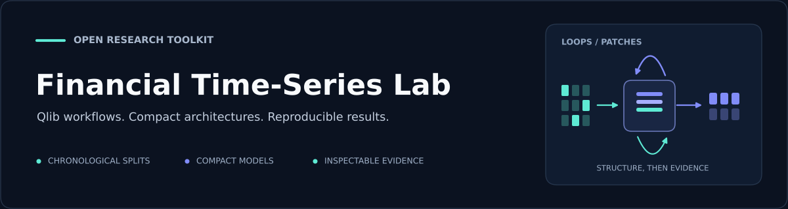

[](https://github.com/BenjiKCF/Neural-Net-with-Financial-Time-Series-Data/actions/workflows/ci.yml)
[](docs/getting-started.md)
[](https://github.com/microsoft/qlib)
[](docs/chenditc-benchmark.md)
[](#quick-start)

**Train financial forecasters, backtest stock portfolios, and inspect Qlib's native diagnostics.** The primary research workflow now uses the latest verified [chenditc Qlib dataset](https://github.com/chenditc/investment_data/releases): daily China-market data with a historical CSI300 universe. Compare eight trainable architectures and four optional official TimesFM variants on a common recent period.

[**Start here**](docs/getting-started.md) · [**Data & results**](#results) · [**Qlib charts**](#native-qlib-diagnostics) · [**Models**](#model-catalog) · [**CSI300 protocol**](docs/chenditc-benchmark.md) · [**Roadmap implementation**](docs/production-implementation.md) · [**GLM loop**](#glm-54-is-a-loop-transformer) · [**Looped TimesFM**](#looped-timesfm-3)

| Start small | Compare fairly | Inspect the evidence |
| --- | --- | --- |
| An offline demo, then a verified market-data download. | Shared universe, target, chronological splits, and validation-only checkpoint selection. | Native Qlib charts, predictions, learning curves, portfolio returns, and data hashes. |

## Quick start

**New to Python?** Follow the [beginner guide](docs/getting-started.md), including Python installation, ZIP download, and common error fixes. The short path below assumes **Python 3.12** is installed. Python 3.13 and newer are not currently supported.

### 1. Get the project

[Download the ZIP](https://github.com/BenjiKCF/Neural-Net-with-Financial-Time-Series-Data/archive/refs/heads/master.zip), extract it, and open a terminal in the folder containing `pyproject.toml`. Or, if you already use Git:

```bash
git clone https://github.com/BenjiKCF/Neural-Net-with-Financial-Time-Series-Data.git
cd Neural-Net-with-Financial-Time-Series-Data
```

### 2. Install — choose your operating system

Run one block below from the project folder. A virtual environment keeps this project's packages together.

<details>
<summary><strong>Windows · PowerShell</strong></summary>

```powershell
py -3.12 -m venv .venv
.\.venv\Scripts\Activate.ps1
python -m pip install --upgrade pip
python -m pip install "torch>=2.5,<3" --index-url https://download.pytorch.org/whl/cpu
python -m pip install -e ".[neural,visualization]"
```

If activation is blocked, use the [activation-free alternative](docs/getting-started.md#if-something-goes-wrong).

</details>

<details>
<summary><strong>macOS · Terminal</strong></summary>

Install [Homebrew](https://brew.sh/) if needed; `libomp` is LightGBM's required OpenMP runtime.

```bash
brew install libomp
python3.12 -m venv .venv
source .venv/bin/activate
python -m pip install --upgrade pip
python -m pip install "torch>=2.5,<3"
python -m pip install -e ".[neural,visualization]"
```

These macOS commands use CPU. The current CLI supports CPU and NVIDIA CUDA; it does not select Apple MPS.

</details>

<details>
<summary><strong>Linux · Terminal</strong></summary>

```bash
python3.12 -m venv .venv
source .venv/bin/activate
python -m pip install --upgrade pip
python -m pip install "torch>=2.5,<3" --index-url https://download.pytorch.org/whl/cpu
python -m pip install -e ".[neural,visualization]"
```

Your distribution may require its Python 3.12 virtual-environment package first; see the [setup guide](docs/getting-started.md#1-install-python-312).

</details>

The dot in `-e ".[neural,visualization]"` means **install this downloaded project**. The extras install the trainable models and native chart exporters. Keep the quotes, and reactivate `.venv` whenever you open a new terminal.

### 3. Check the setup with all eight models

```bash
fts models
fts demo --model all --epochs 1 --device cpu --output runs/my-first-demo
```

This creates synthetic prices, trains the models briefly, and exercises Qlib's prediction and portfolio workflow. Leave the terminal open until it finishes; runtime depends on your computer. For a repeat run, choose a new output folder.

| Open this file | What it tells you |
| --- | --- |
| `runs/my-first-demo/comparison.json` | Metrics for all eight models. |
| `runs/my-first-demo/timesfm3_mini/predictions.csv` | Each date's prediction beside the observed return. |
| `runs/my-first-demo/timesfm3_mini/portfolio.csv` | The example portfolio's daily returns and costs. |

CSV files open in a spreadsheet; JSON files open in a text editor. **Synthetic demo results verify that the software runs.** They do not measure a real trading edge.

### 4. Download chenditc data and run the CSI300 benchmark

```bash
fts download-chenditc --provider .data/cn --release latest
fts benchmark-cn --provider .data/cn --output runs/csi300
fts qlib-report --run-dir runs/csi300/lightgbm --output runs/csi300/plots
```

The first command resolves the current release, verifies its archive and manifest, and creates a Qlib provider. The second trains all eight catalog models and runs the same CSI300 portfolio simulation for each. The third exports Qlib's native plots for the named run; open `runs/csi300/plots/report.html` in your browser. These market-data runs are substantially longer than the synthetic check.

To include the four official TimesFM variants, install `.[timesfm,visualization]`, [download the separately licensed checkpoint](docs/architectures/timesfm.md#timesfm3_pretrained), and add `--timesfm-checkpoint .data/timesfm3-checkpoint` when starting `benchmark-cn`. Use a new output folder when changing the declared roster. See the [complete reproduction guide](docs/chenditc-benchmark.md#reproduce-the-campaign).

## Results

### Latest chenditc dataset · CSI300

The release resolved for this campaign is **[2026-11-26](https://github.com/chenditc/investment_data/releases/tag/2026-11-26)**, checked on 27 November 2026. Its observed market data end on **26 November 2026**. Future-calendar entries are excluded from observations. The earlier SPX experiment used a bundled 1990–2018 index CSV and SPY prices for its backtest; those results remain in the archive below.

| Data and protocol | This campaign |
| --- | --- |
| Source | chenditc `investment_data`, verified `qlib_bin.tar.gz` and matching manifest |
| Downloaded coverage | 2000-01-04–2026-11-26; 6,178 instruments; 17,600,664 finite close observations |
| Research universe | Historical CSI300 membership intervals; 300 members active at the data cutoff |
| Training signals | 2020-01-02–2023-12-27 |
| Validation signals | 2024-01-02–2024-12-27 |
| Test signals | 2025-01-02–2026-11-23 |
| Target | Next-session close to the following close: `close[t+2] / close[t+1] - 1` |
| Portfolio | Qlib Top50/Drop5; CSI300 benchmark; next-close execution; 5/15 bps entry/exit costs |
| Repetition | One declared seed, **42**; up to six neural training epochs |

The three final observed sessions supply the label horizon and Qlib's executor boundary, which is why the last test signal is 23 November. Training uses all eligible CSI300 rows. The seven neural architectures share 157 OHLCV factors, 32-session windows, width 32, and batch size 512; LightGBM uses the same current-day factors. Official TimesFM uses adjusted-close contexts and a separate, explicitly bounded adaptation budget.

<!-- CHENDITC_RESULTS_START -->
All 12 declared model setups are complete and independently audited. The primary scratch model was selected by full-validation daily Rank IC, not test returns. Results use one declared seed (42); the separate official TimesFM setups have different inputs and fitting budgets. These are native Qlib simulations, not an executable profit claim. The source's terminated-series/corporate-action valuation issue remains unresolved.

| Model | Validation Rank IC ↑ | Test RMSE ↓ | Test Rank IC ↑ | Qlib simulated net return | Max drawdown |
| --- | ---: | ---: | ---: | ---: | ---: |
| Zero-return forecast | — | 0.024406 | — | — | — |
| CSI300 benchmark | — | — | — | +2.04% | — |
| LightGBM | 0.003716 | 0.024414 | -0.004868 | +6.69% | -32.90% |
| **Temporal Transformer (validation-selected)** | 0.026105 | 0.024527 | -0.001884 | -0.94% | -28.35% |
| DeepSeek V4.1 Mini | 0.024141 | 0.024456 | 0.002400 | +7.19% | -17.09% |
| GLM-5.4 Loop Mini | 0.016583 | 0.024546 | -0.003553 | -0.57% | -32.06% |
| Qwen4 Mini | 0.016500 | 0.024687 | -0.004387 | -5.20% | -32.64% |
| TimesFM 3 Mini | 0.013550 | 0.024462 | 0.000947 | -17.51% | -34.75% |
| Multiscale Residual Mixer | -0.003143 | 0.024693 | -0.010105 | +6.42% | -37.66% |
| Regime Linear MoE | -0.008169 | 0.024663 | -0.012311 | +6.02% | -37.32% |
| Official TimesFM 3 (128) | -0.002479 | 0.024916 | 0.006558 | -6.50% | -31.29% |
| Official TimesFM 3 (256) | 0.010360 | 0.024710 | 0.003311 | -31.56% | -39.42% |
| Official TimesFM 3 Loop + adapter | -0.002473 | 0.024916 | 0.006548 | -7.72% | -31.95% |
| Official TimesFM 3 Adapter-only | -0.002474 | 0.024916 | 0.006550 | -7.72% | -31.95% |

[Full comparison CSV](reports/chenditc_csi300/comparison.csv) · [Numerical audit](reports/chenditc_csi300/audit.json)
<!-- CHENDITC_RESULTS_END -->

[Dataset provenance, model roster, execution assumptions, and reproduction](docs/chenditc-benchmark.md)

**Known portfolio valuation issue:** the completed LightGBM replay carries a holding in `SH600837` after its price series ends on 2025-02-05. Qlib keeps the last price for 440 portfolio dates; that holding accounts for about **1.94% of final simulated account value**. Portfolio numbers are therefore labeled **Qlib simulated returns**, pending correct corporate-action treatment. The universe remains historical; the stopped series has not been retrospectively deleted. Forecast errors use available labels. [Concrete data-quality finding](docs/chenditc-benchmark.md#terminated-series-and-portfolio-valuation).

### Native Qlib diagnostics

The report exporter calls Qlib's own `report_graph`, `score_ic_graph`, `risk_analysis_graph`, and `model_performance_graph`. Each run produces PNGs, inspectable Plotly JSON, and a self-contained interactive HTML report.

<!-- CHENDITC_GALLERY_START -->
**Validation-selected model: Temporal Transformer.** These figures are generated from the audited full test forecasts and deterministic Qlib portfolio replay. [Offline interactive report](docs/assets/qlib/report.html) · [Chart provenance and hashes](docs/assets/qlib/manifest.json)

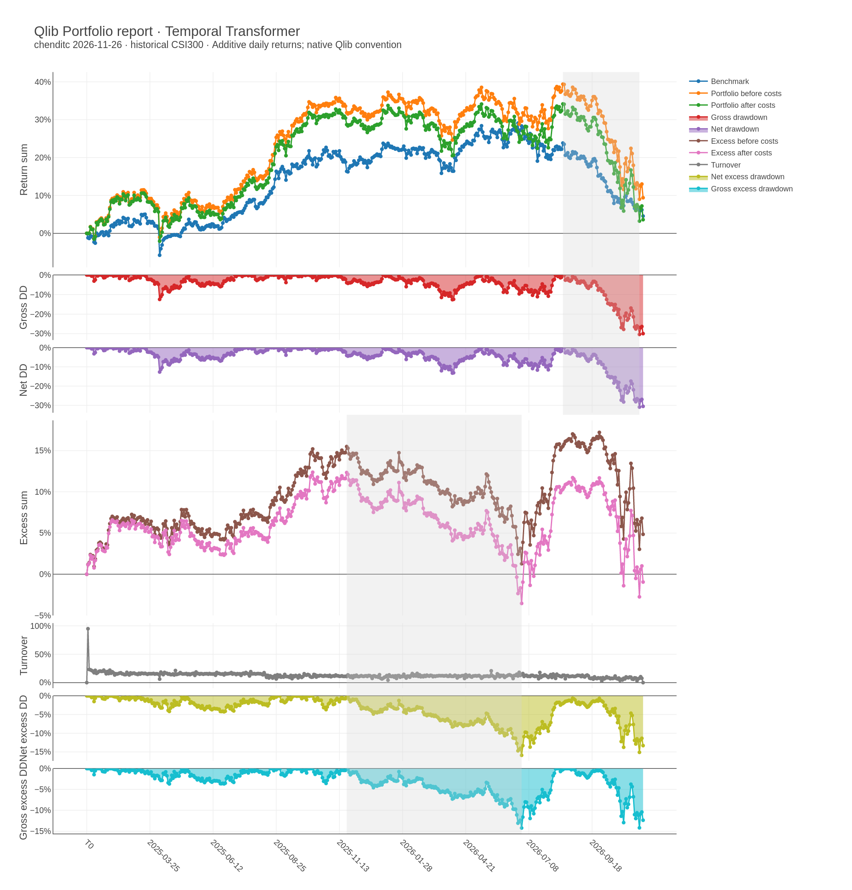

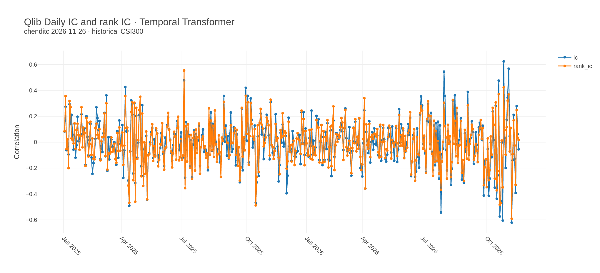

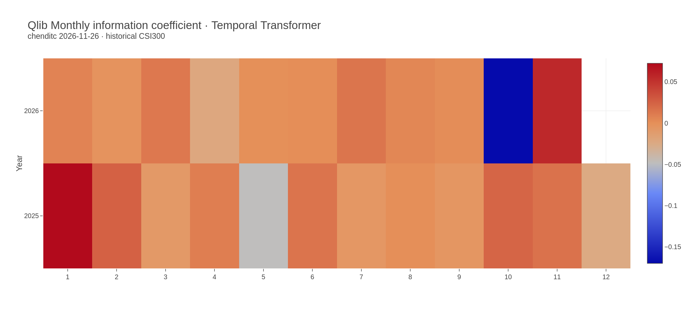

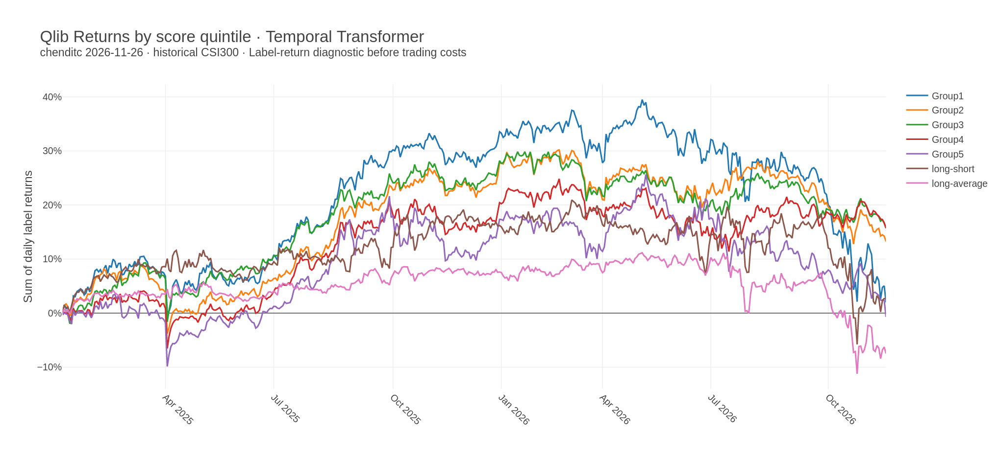

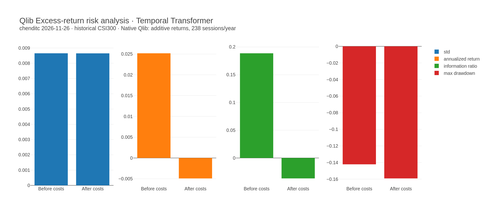

[All additional native Qlib diagnostics](docs/assets/qlib/)
<!-- CHENDITC_GALLERY_END -->

**Read the conventions:** native Qlib curves add daily returns; they are not compounded NAV. Qlib's default daily risk plots annualize with 238 sessions. The model-comparison table uses compounded portfolio returns and, where stated, 252-session CAGR. Quintile return plots diagnose forecast ranking before costs; the Top50 backtest includes the declared trading costs. [Chart guide](docs/chenditc-benchmark.md#read-the-native-qlib-charts).

### Archived SPX and SPY experiments

<details>
<summary><strong>Open the 2013–2018 SPX results, SPY backtests, and ES/weight-edit experiments</strong></summary>

These completed experiments use a different market, period, universe, and trading rule from the CSI300 campaign. Their scores and multi-seed results are preserved for reproducibility.

### Common-period forecasts and SPY backtest

**The new TimesFM mini ensemble has the lowest forecast error; SPY buy-and-hold has the highest net return in this comparison.** Loop fine-tuning improves the official TimesFM checkpoint's RMSE slightly, but does not beat the mini model or the zero-return forecast. The two new architectures also fall short. These are completed experiments, including the unsuccessful candidates.

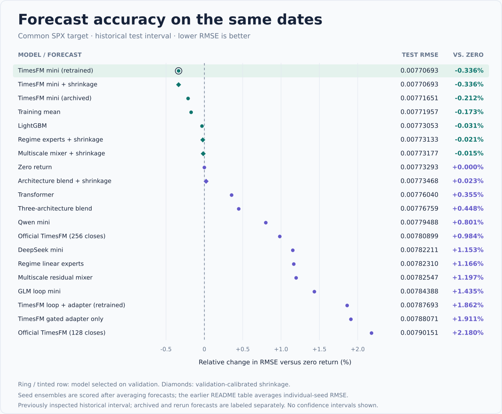

All test forecasts use the same **1,438 SPX dates, 24 January 2013–8 October 2018**. Scratch-model rows below average the predictions from seeds **7, 42, and 2026 before scoring**. That ensemble RMSE differs from the mean of individual seed RMSEs in the original table further down.

| Forecast / strategy | Test RMSE ↓ | Net return | Annualized return | Max drawdown |
| --- | ---: | ---: | ---: | ---: |
| **SPY buy-and-hold** | — | **107.23%** | **13.62%** | −13.02% |
| Zero return / cash | 0.00773293 | 0.00% | 0.00% | 0.00% |
| LightGBM | 0.00773053 | 92.13% | 12.13% | −16.80% |
| TimesFM mini, archived ensemble | 0.00771651 | 81.35% | 11.00% | −14.76% |
| **TimesFM mini, newly trained ensemble** | **0.00770693** | **65.10%** | **9.19%** | −13.03% |
| Official TimesFM, 128 closes | 0.00790151 | 35.38% | 5.45% | −13.85% |
| TimesFM loop + adapter, retrained | 0.00787693 | 34.40% | 5.32% | −13.79% |
| TimesFM gated adapter-only control | 0.00788071 | 33.86% | 5.24% | −13.57% |
| New multiscale residual mixer | 0.00782547 | 15.69% | 2.59% | −10.42% |
| New regime-gated linear experts | 0.00782310 | 15.73% | 2.59% | −8.78% |

The trading rule is fixed: **positive forecast → hold SPY; otherwise hold cash**. A signal observed after close **t** trades at close **t+1**, then earns the **t+1 → t+2** return. The table assumes **5 basis points each way**, including the initial purchase and final sale. SPY adjusted closes supply a dividend-adjusted return proxy; they are not executable fill quotes. Cash earns zero. The portfolio period is **25 January 2013–10 October 2018**.

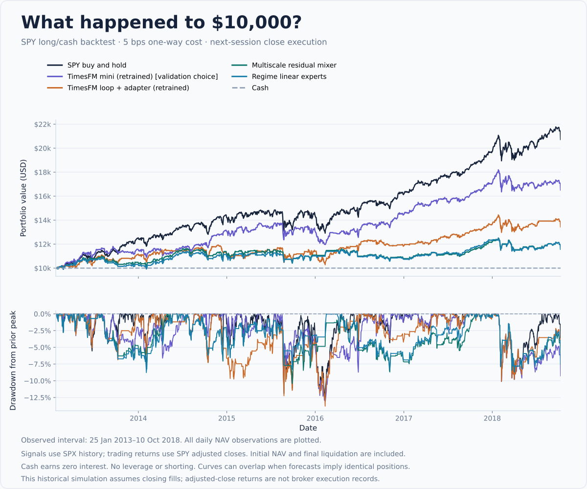

The newly trained mini ensemble was selected by validation RMSE before its test predictions were generated. Its test RMSE is **0.124% below the archived mini ensemble**, but the paired block-bootstrap interval for the RMSE difference includes zero. It also trades more often and has a lower net return. **This does not establish an improved trading edge.** The historical test interval had already been inspected, so the follow-up is exploratory.

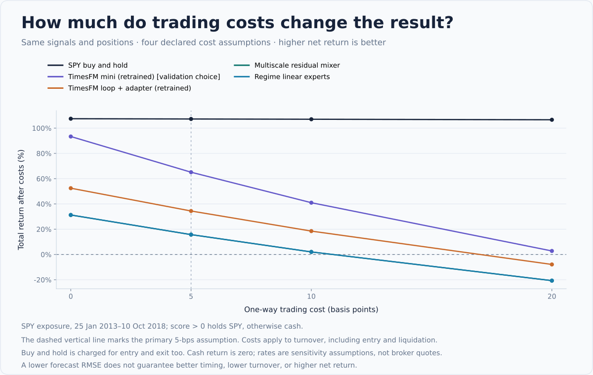

**Why validation was around 0.016 rather than 0.0077:** it uses the same SPX dataset and target, but a different period. The full validation interval's zero-return RMSE is **0.01599491**, versus **0.00773293** on test: about **2.07× the target scale**. The original TimesFM pilot also used only 128 sampled validation rows. Comparing those numbers directly confounds the period and sample with model quality.

[Full results and interpretation](docs/financial-research.md) · [All model/cost results](reports/financial_research/comparison.csv) · [Aligned predictions](reports/financial_research/predictions.csv) · [Equity curves](reports/financial_research/equity.csv) · [Protocol and sources](reports/financial_research/settings.json)

#### Replay this backtest without training or downloading prices

After installation, run this single command from the project folder:

```bash
fts backtest --predictions reports/financial_research/predictions.csv --spy-csv reports/financial_research/spy_prices.csv --output runs/my-backtest
```

Open `runs/my-backtest/metrics.csv` for the result table and `ledger.csv` for each signal, position, fee and portfolio value. The supplied predictions and adjusted-price window make this replay fully offline. See the [beginner explanation](docs/getting-started.md#7-replay-the-recorded-spy-backtest).

### Paper-inspired post-training: ES and directional weight editing

We tested [evolution strategies](https://arxiv.org/html/2509.24372v3) and a [directional weight-editing idea](https://arxiv.org/html/2611.21885v2) on the validation-selected mini ensemble. These are forecasting adaptations; the small model is not a reasoning LLM that rewrites itself.

**The ES improvement is too small to establish a better forecaster, and trading performance declined.** The declared primary run lowers RMSE by **0.0083%**, while its paired 95% RMSE-difference interval includes zero. All three optimizer seeds have slightly lower RMSE and lower net return.

| Method | Test RMSE ↓ | Net return at 5 bps | Trades |
| --- | ---: | ---: | ---: |
| Current mini ensemble | 0.00770693 | 65.10% | 316 |
| Directional weight edit | 0.00770693 | 65.10% | 316 |
| ES, predeclared seed 42 | 0.00770629 | 62.72% | 342 |
| Directional edit then ES | 0.00770629 | 62.72% | 342 |
| Random-direction control | 0.00770689 | 63.91% | 316 |
| SPY buy-and-hold | — | 107.23% | 2 |

Validation selected **zero attenuation** for the diagnosed edit, so the combined arm is exactly ES alone. That is a rejected edit, not evidence that combining the papers works. Every proposal seed and reward, generation result, selected checkpoint, prediction, and fee scenario is retained.

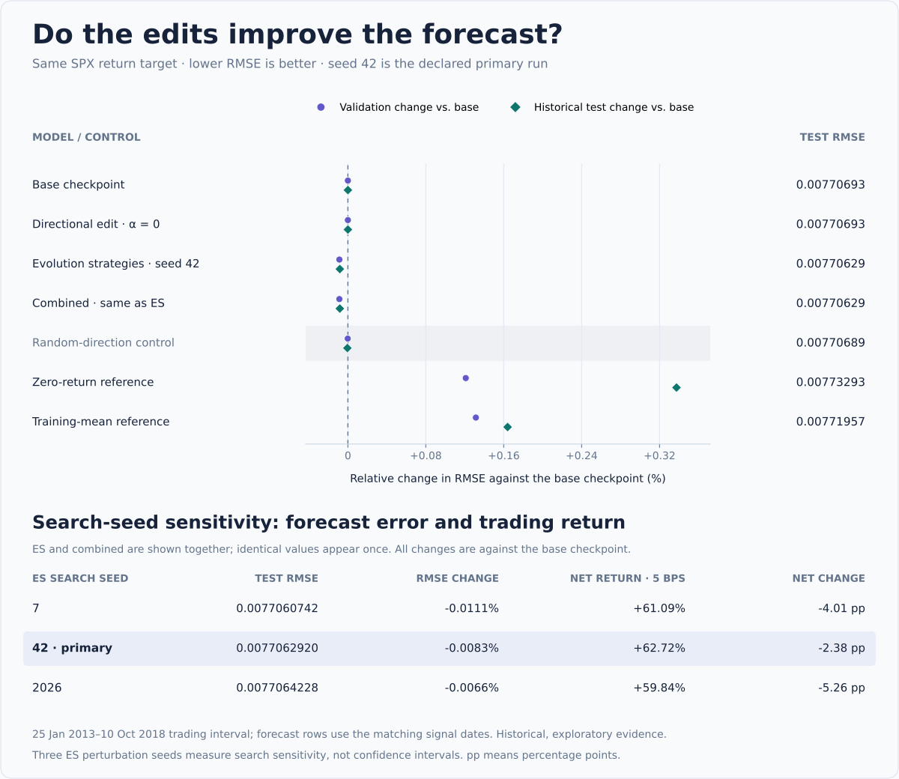

[Full experiment, figures, and interpretation](docs/paper-posttraining.md) · [Registered protocol](reports/paper_posttraining/protocol.json) · [All results](reports/paper_posttraining/metrics.csv) · [Independent replay](reports/paper_posttraining/independent_audit.json)

Replay its backtest offline:

```bash
fts backtest --predictions reports/paper_posttraining/predictions.csv --spy-csv reports/paper_posttraining/spy_prices.csv --output runs/my-paper-backtest
```

### Original six-model comparison: mean of three seed scores

The table reports the completed **18-run comparison** on the bundled S&P 500 history. Each trial has **1,438 test predictions**, from **24 January 2013 to 8 October 2018**. RMSE measures return-prediction error in decimal return units; **lower is better**.

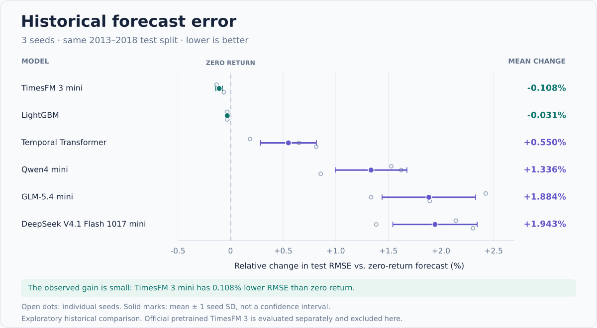

| Model | Parameters in this experiment | Mean test RMSE ↓ | Seed standard deviation |
| --- | ---: | ---: | ---: |
| Zero-return forecast | 0 | 0.00773293 | — |
| LightGBM | Trees | 0.00773053 | 0.00000000 |
| Plain Transformer | 30,561 | 0.00777545 | 0.00002057 |
| DeepSeek V4.1 Flash 1017 mini | 103,969 | 0.00788319 | 0.00003098 |
| **GLM-5.4 loop Transformer mini** | 45,189 | 0.00787864 | 0.00003437 |
| Qwen4 mini | 122,258 | 0.00783621 | 0.00002633 |
| **TimesFM 3 mini** | **30,157** | **0.00772459** | **0.00000243** |

TimesFM 3 mini has the lowest mean error here, but its improvement over zero return is only **0.108% in relative RMSE**. LightGBM is essentially tied with zero return. The other neural models are worse under this fixed protocol.

The seeds are **7, 42, and 2026**; every seed is retained. Seed standard deviation is initialization dispersion, **not a confidence interval**. Neural models share a 32-session history and training budget, while parameter counts and effective depth differ. This previously inspected, single-index interval does not establish current-market generalization or profitability.

[Read the experiment](docs/architecture-validation.md) · [Full settings and learning curves](reports/architecture_benchmark.json) · [All trial scores](reports/architecture_benchmark.csv) · [Aligned predictions](reports/architecture_predictions.csv)

### Separate official pretrained TimesFM 3 replay

| Model | Parameters | Test RMSE ↓ | Evaluation scope |
| --- | ---: | ---: | --- |
| Official pretrained TimesFM 3 | 330,710,976 | 0.00780899 | Fixed weights; 256 historical closes per forecast; unknown pretraining overlap. |

This actual-checkpoint replay was worse than zero return. Its input and training history differ from the scratch models above. It is a separate experiment, with an explicit local download and a noncommercial weight license. [Setup and provenance](docs/architectures/timesfm.md#timesfm3_pretrained).

</details>

## Model catalog

The `*_mini` models are independently implemented, **randomly initialized numeric adaptations** of disclosed architecture ideas. They use financial factors and a scalar return head. Their documentation identifies what is retained, adapted, or omitted; they contain no pretrained flagship weights.

| CLI model | What you can study | Configuration / architecture |
| --- | --- | --- |
| `lightgbm` | A tabular gradient-boosted-tree control. | [Config](configs/lightgbm.yaml) |
| `transformer` | A conventional temporal attention control. | [Config](configs/transformer.yaml) |
| `deepseek_v41_mini` | Causal encoder/decoder, compressed retrieval, shared KV/index reuse, hyper-connections, and experts. | [Config](configs/deepseek_v41_mini.yaml) · [Notes](docs/architectures/deepseek.md) |
| `glm54_mini` | **A loop Transformer:** the same attention/MoE blocks refine the hidden state over repeated passes. | [Config](configs/glm54_mini.yaml) · [Notes](docs/architectures/glm_qwen.md#glm-54-adaptation-a-loop-transformer) |
| `qwen4_mini` | Three gated-delta mixers per sparse-attention mixer, four residual streams, and experts. | [Config](configs/qwen4_mini.yaml) · [Notes](docs/architectures/glm_qwen.md#qwen4-adaptation) |
| `timesfm3_mini` | Temporal/variate mixing, patches, prefix normalization, and forecast refinement. | [Config](configs/timesfm3_mini.yaml) · [Notes](docs/architectures/timesfm.md#timesfm3_mini) |
| `multiscale_residual_mixer` | Four causal historical scales, a linear forecast path, and a small gated convolution/MLP residual. | [Config](configs/multiscale_residual_mixer.yaml) · [Notes](docs/architectures/financial.md#multiscale-residual-mixer) |
| `regime_linear_moe` | Three linear experts mixed by a gate using historical feature descriptors. | [Config](configs/regime_linear_moe.yaml) · [Notes](docs/architectures/financial.md#regime-gated-linear-experts) |
| `timesfm3_pretrained` | Google's fixed-weight model through an explicit local-checkpoint adapter. | [Config](configs/timesfm3_pretrained.yaml) · [Notes](docs/architectures/timesfm.md#timesfm3_pretrained) |

`fts demo --model all` and `fts benchmark-cn` include the eight trainable models. Adding a local checkpoint to `benchmark-cn` includes frozen TimesFM with 128/256 closes, loop + adapter with 128 closes, and a matched adapter-only control. These official models retain different inputs and pretraining from the scratch architectures.

### GLM-5.4 is a loop Transformer

The shipped configuration has **two distinct Transformer blocks and two passes**. The execution order is block 0 → block 1 → **the same block 0 → the same block 1**. Attention and expert weights are shared; each block/pass has its own learned token gate.

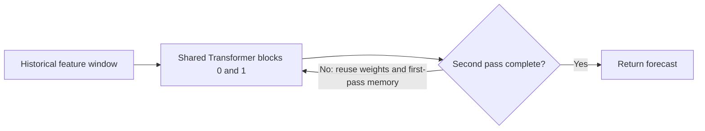

The later pass reuses first-pass global keys/values and sparse indices, then adds fresh local keys/values. Looping refines the representation of the same observed window; it does not advance the time cutoff. Tests verify shared block identity, indexer call counts, memory reuse, and gradient flow. See the [implementation](src/financial_ts/architectures/glm.py) and [loop mechanics](docs/architectures/glm_qwen.md).

## How the workflow stays chronological

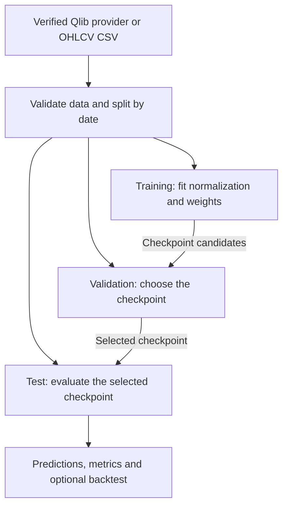

Features observed through close **t** predict `close[t+2] / close[t+1] - 1`. Two actual trading sessions are purged at split boundaries to prevent labels crossing into the next partition. Normalization is fitted on training data only. [Data, target, and execution details](docs/workflow-guide.md#target-timing-and-leakage-controls).

## Archived SPX examples

<details>
<summary><strong>Use the bundled index CSV or reproduce the original three-seed comparison</strong></summary>

The included `^GSPC.csv` works offline. Import it once, then train a model:

```bash
fts import-csv --csv "^GSPC.csv" --symbol SPX --provider .data/my-spx
fts train --config configs/glm54_mini.yaml --provider .data/my-spx --output runs/my-glm --device cpu --no-backtest
```

The **provider** is the local data folder Qlib reads. This old index is a forecasting example; `--no-backtest` avoids treating the index itself as a directly tradable security. For your own data, use a daily CSV containing `date,symbol,open,high,low,close,volume` and follow the [adjustment contract](docs/workflow-guide.md#import-your-own-market-data).

### Reproduce the three-seed architecture comparison

```bash
fts benchmark --provider .data/my-spx --output runs/my-comparison --models lightgbm transformer deepseek_v41_mini glm54_mini qwen4_mini timesfm3_mini --seeds 7 42 2026 --epochs 12 --device cpu
```

This reproduces the original six-model roster under three seeds. Omitting `--models` also includes the two newer research architectures (24 runs total). It is a longer research job than the one-epoch demo. Every output includes configurations and provenance; nothing is silently overwritten.

</details>

## Looped TimesFM 3

**Experimental: convert the official pretrained model into a shared-depth loop and fine-tune lightweight gates/adapters.** This is a separate research adaptation; Google's released TimesFM 3 remains unchanged.

The conversion keeps the 20 pretrained layers, freezes their weights, and replays the same middle four layers once. Zero-initialized gates and adapter output preserve the original forecast at initialization. The extra pass adds computation without duplicating the pretrained layers.

| Component | Experiment configuration |
| --- | --- |
| Frozen base | Official TimesFM 3, 330,710,976 parameters |
| Reused body | Layers 8–11, zero-based; two passes total |
| Effective depth | 24 layer evaluations using 20 original layer objects |
| Trainable addition | 21,761 gate and rank-8 adapter parameters |
| Selection | Training labels for updates; validation chooses the saved adapter, including the unchanged initialization |
| New CSI300 campaign | 1,024 training samples, 512 selection samples, three epochs; complete validation/test inference for the declared panel |

The CSI300 comparison reruns the frozen checkpoint, loop + adapter, and matched adapter-only control on the new dataset. The miniature `timesfm3_mini` is a separate model trained from scratch. [All variant definitions and budgets](docs/chenditc-benchmark.md#models-and-training-budget).

<details>
<summary><strong>Open the archived SPX checkpoint pilot and its follow-up results</strong></summary>

### Actual checkpoint fine-tuning pilot

The fixed CPU run used **256 training examples, 128 validation examples, one seed, and three epochs**. Each example contains 128 observed closes. All epochs ran; validation selected epoch 2 from the unchanged checkpoint and all three trained states.

| State | Validation RMSE ↓ | Role |
| --- | ---: | --- |
| Zero-return forecast | 0.01589699 | Reference on the same validation rows |
| Unchanged pretrained checkpoint / epoch 0 | 0.01600509 | Eligible baseline |
| Epoch 1 | 0.01598686 | 64 optimizer updates |
| **Epoch 2** | **0.01587005** | **Selected; 128 optimizer updates** |
| Epoch 3 | 0.01599213 | 192 optimizer updates |

The original selected state had **0.844% lower sampled-validation RMSE than the unchanged checkpoint**. Initial forecasts matched exactly, and reloading that selected adapter reproduced its checked predictions exactly. This remains a **combined loop-and-adapter feasibility pilot**, not evidence that looping itself caused the gain. [Original protocol and saved evidence](docs/timesfm-loop-validation.md).

The follow-up now includes the full validation/test periods and a **parameter-matched gated adapter-only control**. The original private adapter was unavailable after the temporary environment reset, so the original recipe was rerun once. Its selected epoch stayed at 2, with small numerical differences; the new result is explicitly labeled **a fresh retrain**, not restoration of the old weights. Loop test RMSE is **0.00787693**, versus **0.00788071** for the control and **0.00790151** for the frozen model. The control has the same trainable parameter count but less computation and a different gate role, so the small gap does not isolate a causal benefit from looping. [Completed comparison and reproducibility limits](docs/financial-research.md#timesfm-loop-and-adapter-comparison).

The optional command is:

```bash
python -m pip install -e ".[timesfm]"
# Download the separately licensed checkpoint using the linked guide first.
fts finetune-timesfm --provider .data/my-spx --checkpoint .data/timesfm3-checkpoint --output runs/my-timesfm-loop --device cpu
```

See [the loop architecture and API](docs/architectures/timesfm-loop.md), [checkpoint download instructions](docs/architectures/timesfm.md#timesfm3_pretrained), and [reproduction command](docs/timesfm-loop-validation.md#reproduce-the-pilot). The experiment saves learned adapters locally; **neither checkpoint nor trained adapters are redistributed**. The official [TimesFM license](https://huggingface.co/google/timesfm-3.0-pytorch/blob/43046b85ec22d584a13f8098c2ed39c889e129c2/LICENSE) covers noncommercial, nonproduction research and restricts redistribution of derivatives. Historical pretraining overlap remains unknown.

</details>

## Production roadmap implementation

The roadmap now has runnable research and operational workflows: source-time data
contracts, a corporate-action ledger, registered rolling evaluation, same-date
objectives and attention models, numerical inference bundles, a version registry,
and a daily shadow runner. [Implementation and evidence](docs/production-implementation.md)
records the completed work and remaining promotion gates.

**The retained 40-trial screen does not establish a new trading advantage.**
It used two folds, two seeds and two neural epochs. Validation selected the
ranking objective in both folds, followed by negative held-out Rank IC:

| Registered selection | Validation Rank IC | Held-out Rank IC |
| --- | ---: | ---: |
| Fold 000 · `daily_ranking` | +0.0665 | −0.0291 |
| Fold 001 · `daily_ranking` | +0.0776 | −0.0659 |

[All candidates, budgets and interpretation](docs/rolling-screening.md). Both
favorable and unfavorable outcomes remain visible; the held-out scores did not
change the registered selection.

| Capability | Run or inspect |
| --- | --- |
| Rolling folds, declared seeds and complete trial history | `fts rolling-evaluate` · [completed 40-trial screen](docs/rolling-screening.md) · [five-seed recipe](configs/rolling_full.json) |
| Daily MSE/Huber/IC/ranking objectives; MASTER-style and regime MoE | [Cross-sectional models and controls](docs/architectures/cross-sectional.md) |
| Validation-selected LightGBM/neural blends | `fts rolling-blend` · [completed 32-scenario comparison](docs/rolling-blend.md) |
| Joint 1/5/20-session heads, quantiles and mature-label adaptation | `fts research-advanced` · [actual bounded screen](reports/production_roadmap/advanced_screening/results.json) |
| DoubleAdapt-style meta-learning and matched controls | `fts research-doubleadapt` · [method and evidence](docs/doubleadapt.md) |
| Measured inference latency, memory and precision | [FP32/bfloat16 profile](docs/precision-profile.md); FP32 retained after the rank-stability gate failed |
| Availability, refresh quarantine and corporate actions | `fts snapshot-audit`, `fts lifecycle-assess` · [source-backed accounting](docs/data-lifecycle.md) |
| Immutable inference, daily scheduling, monitoring and rollback | [Operations guide](docs/production-operation.md) · `fts daily-infer` · `fts scheduled-shadow` |
| Durable paper execution | `fts paper-replay` · [reconciled demonstration](reports/production_roadmap/paper_session_demo/completion.json) |

```bash
fts download-chenditc --provider .data/cn-20261126 --release 2026-11-26
fts rolling-evaluate --provider .data/cn-20261126 \
  --config configs/rolling_screening.json --output runs/rolling-screen
fts rolling-blend --campaign runs/rolling-screen --output runs/rolling-blend
fts paper-replay --spec configs/paper_session_demo.json --output runs/paper-demo
```

The new protocols retain unfavorable and failed trials. Model selection uses
validation only. The advanced screen shows improvements for some horizons and
regressions for others; it does not establish an overall superior model. The
archived accounting assessment still identifies **6.49% of final simulated NAV**
in unresolved terminated-series holdings. Prospective observations, complete
lifecycle settlement and reviewed model/data rights remain required for promotion.
The registry enforces separate research, shadow and production decisions.

Native Qlib diagnostics are also saved for the exploratory rolling Transformer
control, fold 000, seed 7. This is a declared control, with its unfavorable result
retained. The [complete native gallery](docs/assets/rolling/transformer-fold000/report.html)
includes portfolio, risk, group-return and IC diagnostics, with source hashes in
its [manifest](docs/assets/rolling/transformer-fold000/manifest.json).

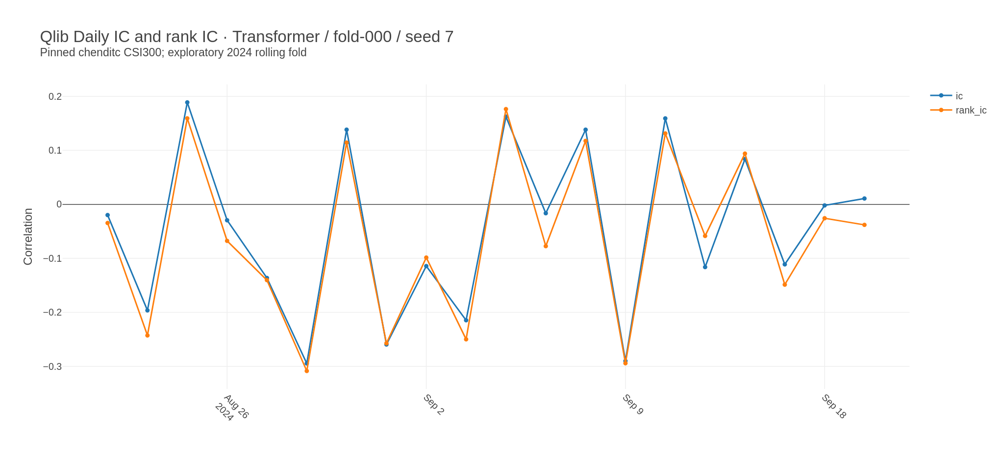

The archived [563-test acceptance](reports/production_roadmap/acceptance.json)
and frozen-source research retain their original identities. The later
[570-test software verification](docs/validation/production-software.json) covers
calendar-coverage and prediction-manifest hardening. The latest
[600-test publication verification](docs/validation/production-publication.json)
also covers standalone bundle export, valuation-calendar coverage and exact
archive reassembly. CI reconstructs the archive and verifies all 1,724 files and
1,556 receipt-listed artifacts. These are separate records; the retained
experiments were not rerun on the later code.

[Roadmap and gates](docs/production-roadmap.md) ·
[Implementation evidence](docs/production-implementation.md) ·
[Operating instructions](docs/production-operation.md)

## Explore further

| I want to… | Read this |
| --- | --- |
| Install it and understand my first output | [Getting started](docs/getting-started.md) |
| Download chenditc data, reproduce CSI300, or interpret native Qlib plots | [CSI300 benchmark guide](docs/chenditc-benchmark.md) |
| Change features, models, splits, or portfolio costs | [Workflow and configuration](docs/workflow-guide.md) |
| Run or inspect the roadmap implementation | [Software and evidence map](docs/production-implementation.md) · [Operation guide](docs/production-operation.md) |
| Review the rolling models and tree/neural ensemble | [40-trial screen](docs/rolling-screening.md) · [Blend results](docs/rolling-blend.md) · [Analysis audit](docs/rolling-analysis-audit.md) |
| Understand remaining production acceptance | [Production roadmap and gates](docs/production-roadmap.md) · [Data and lifecycle contracts](docs/data-lifecycle.md) |
| Inspect the archived six-model SPX benchmark | [Original validation report](docs/architecture-validation.md) |
| Inspect the archived TimesFM comparison and SPY backtest | [Common-period research and backtest](docs/financial-research.md) |
| Understand the architecture adaptations | [DeepSeek](docs/architectures/deepseek.md) · [GLM/Qwen](docs/architectures/glm_qwen.md) · [TimesFM](docs/architectures/timesfm.md) |
| Load the official TimesFM checkpoint | [Pretrained inference](docs/architectures/timesfm.md#timesfm3_pretrained) |
| Inspect the removed notebook pipeline | [Legacy audit and Git history](docs/legacy-audit.md) |

### Development

```bash
python -m pip install -e ".[dev,neural]"
ruff check src tests
python -m pytest -q
```

CI exercises Python 3.10 and 3.12 with CPU PyTorch, including the eight-model offline demo and the saved historical backtest. Actual official-checkpoint experiments are documented separately; CI uses small test doubles and does not download those weights.

Built with [Microsoft Qlib](https://github.com/microsoft/qlib) and [PyTorch](https://pytorch.org/). The [dependency policy](docs/workflow-guide.md#dependency-policy) explains the supported versions. Legacy notebooks and unused artifacts were removed; the original material remains in Git history.

