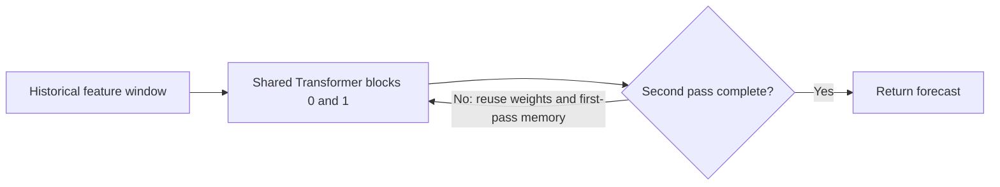
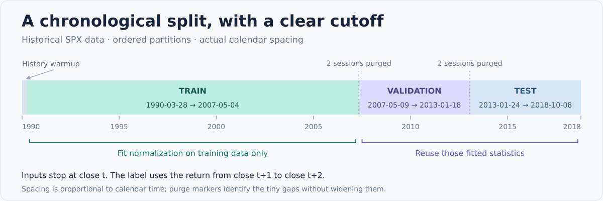
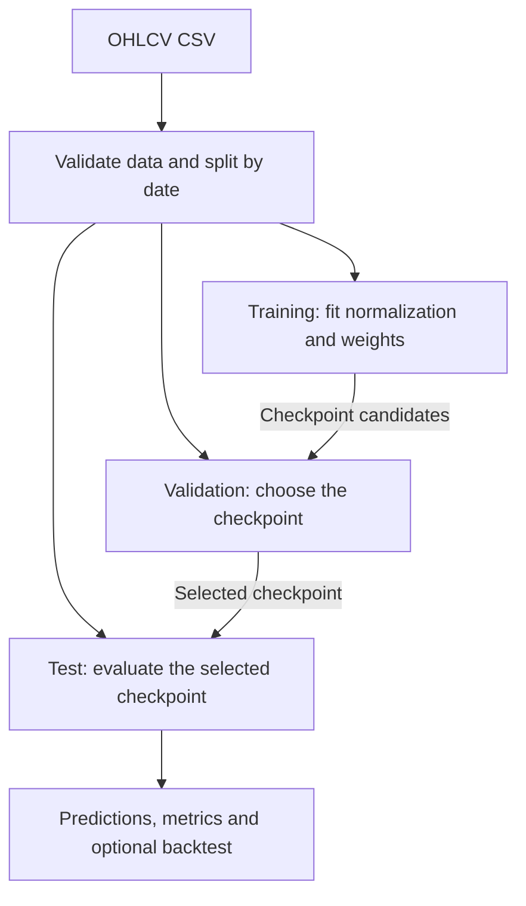

# Neural Networks with Financial Time-Series Data


[](https://github.com/BenjiKCF/Neural-Net-with-Financial-Time-Series-Data/actions/workflows/ci.yml)
[](docs/getting-started.md)
[](https://github.com/microsoft/qlib)
[](#quick-start)

**Train and compare financial forecasters with Qlib and PyTorch.** Explore compact DeepSeek V4.1, GLM-5.4, Qwen4, and TimesFM 3 architectures alongside LightGBM and a plain Transformer. Start with generated example data, then use your own daily market CSVs.

[**Start here**](docs/getting-started.md) · [**Results**](#results) · [**Models**](#model-catalog) · [**GLM loop**](#glm-54-is-a-loop-transformer) · [**Looped TimesFM**](#looped-timesfm-3) · [**Detailed guide**](docs/workflow-guide.md)

| Start small | Compare fairly | Inspect the evidence |
| --- | --- | --- |
| An offline demo; no API key or GPU needed. | Shared data, target, chronological splits, and validation-only checkpoint selection. | Predictions, learning curves, metrics, configuration, and data hashes are exported. |

## Quick start

**New to Python?** Follow the [beginner guide](docs/getting-started.md), including Python installation, ZIP download, and common error fixes. The short path below assumes **Python 3.12** is installed. Python 3.13 and newer are not currently supported.

### 1. Get the project

[Download the ZIP](https://github.com/BenjiKCF/Neural-Net-with-Financial-Time-Series-Data/archive/refs/heads/master.zip), extract it, and open a terminal in the folder containing `pyproject.toml`. Or, if you already use Git:

```bash
git clone https://github.com/BenjiKCF/Neural-Net-with-Financial-Time-Series-Data.git
cd Neural-Net-with-Financial-Time-Series-Data
```

### 2. Install — choose your operating system

Run one block below from the project folder. A virtual environment keeps this project's packages together.

<details>
<summary><strong>Windows · PowerShell</strong></summary>

```powershell
py -3.12 -m venv .venv
.\.venv\Scripts\Activate.ps1
python -m pip install --upgrade pip
python -m pip install "torch>=2.5,<3" --index-url https://download.pytorch.org/whl/cpu
python -m pip install -e ".[neural]"
```

If activation is blocked, use the [activation-free alternative](docs/getting-started.md#if-something-goes-wrong).

</details>

<details>
<summary><strong>macOS · Terminal</strong></summary>

Install [Homebrew](https://brew.sh/) if needed; `libomp` is LightGBM's required OpenMP runtime.

```bash
brew install libomp
python3.12 -m venv .venv
source .venv/bin/activate
python -m pip install --upgrade pip
python -m pip install "torch>=2.5,<3"
python -m pip install -e ".[neural]"
```

These macOS commands use CPU. The current CLI supports CPU and NVIDIA CUDA; it does not select Apple MPS.

</details>

<details>
<summary><strong>Linux · Terminal</strong></summary>

```bash
python3.12 -m venv .venv
source .venv/bin/activate
python -m pip install --upgrade pip
python -m pip install "torch>=2.5,<3" --index-url https://download.pytorch.org/whl/cpu
python -m pip install -e ".[neural]"
```

Your distribution may require its Python 3.12 virtual-environment package first; see the [setup guide](docs/getting-started.md#1-install-python-312).

</details>

The dot in `-e ".[neural]"` means **install this downloaded project**. There is no need to find a similarly named package on PyPI. Keep the quotes, and reactivate `.venv` whenever you open a new terminal.

### 3. Run all six models

```bash
fts models
fts demo --model all --epochs 1 --device cpu --output runs/my-first-demo
```

This creates synthetic prices, trains the models briefly, and exercises Qlib's prediction and portfolio workflow. Leave the terminal open until it finishes; runtime depends on your computer. For a repeat run, choose a new output folder.

| Open this file | What it tells you |
| --- | --- |
| `runs/my-first-demo/comparison.json` | Metrics for all six models. |
| `runs/my-first-demo/timesfm3_mini/predictions.csv` | Each date's prediction beside the observed return. |
| `runs/my-first-demo/timesfm3_mini/portfolio.csv` | The example portfolio's daily returns and costs. |

CSV files open in a spreadsheet; JSON files open in a text editor. **Synthetic demo results verify that the software runs.** They do not measure a real trading edge.

## Results

### Six models, three seeds, one recorded protocol

The table reports the completed **18-run comparison** on the bundled S&P 500 history. Each trial has **1,438 test predictions**, from **24 January 2013 to 8 October 2018**. RMSE measures return-prediction error in decimal return units; **lower is better**.


| Model | Parameters in this experiment | Mean test RMSE ↓ | Seed standard deviation |
| --- | ---: | ---: | ---: |
| Zero-return forecast | 0 | 0.00773293 | — |
| LightGBM | Trees | 0.00773053 | 0.00000000 |
| Plain Transformer | 30,561 | 0.00777545 | 0.00002057 |
| DeepSeek V4.1 Flash 1017 mini | 103,969 | 0.00788319 | 0.00003098 |
| **GLM-5.4 loop Transformer mini** | 45,189 | 0.00787864 | 0.00003437 |
| Qwen4 mini | 122,258 | 0.00783621 | 0.00002633 |
| **TimesFM 3 mini** | **30,157** | **0.00772459** | **0.00000243** |

TimesFM 3 mini has the lowest mean error here, but its improvement over zero return is only **0.108% in relative RMSE**. LightGBM is essentially tied with zero return. The other neural models are worse under this fixed protocol.

The seeds are **7, 42, and 2026**; every seed is retained. Seed standard deviation is initialization dispersion, **not a confidence interval**. Neural models share a 32-session history and training budget, while parameter counts and effective depth differ. This previously inspected, single-index interval does not establish current-market generalization or profitability.

[Read the experiment](docs/architecture-validation.md) · [Full settings and learning curves](reports/architecture_benchmark.json) · [All trial scores](reports/architecture_benchmark.csv) · [Aligned predictions](reports/architecture_predictions.csv)

### Separate official pretrained TimesFM 3 replay

| Model | Parameters | Test RMSE ↓ | Evaluation scope |
| --- | ---: | ---: | --- |
| Official pretrained TimesFM 3 | 330,710,976 | 0.00780899 | Fixed weights; 256 historical closes per forecast; unknown pretraining overlap. |

This actual-checkpoint replay was worse than zero return. Its input and training history differ from the scratch models above. It is a separate experiment, with an explicit local download and a noncommercial weight license. [Setup and provenance](docs/architectures/timesfm.md#timesfm3_pretrained).

## Model catalog

The `*_mini` models are independently implemented, **randomly initialized numeric adaptations** of disclosed architecture ideas. They use financial factors and a scalar return head. Their documentation identifies what is retained, adapted, or omitted; they contain no pretrained flagship weights.

| CLI model | What you can study | Configuration / architecture |
| --- | --- | --- |
| `lightgbm` | A tabular gradient-boosted-tree control. | [Config](configs/lightgbm.yaml) |
| `transformer` | A conventional temporal attention control. | [Config](configs/transformer.yaml) |
| `deepseek_v41_mini` | Causal encoder/decoder, compressed retrieval, shared KV/index reuse, hyper-connections, and experts. | [Config](configs/deepseek_v41_mini.yaml) · [Notes](docs/architectures/deepseek.md) |
| `glm54_mini` | **A loop Transformer:** the same attention/MoE blocks refine the hidden state over repeated passes. | [Config](configs/glm54_mini.yaml) · [Notes](docs/architectures/glm_qwen.md#glm-54-adaptation-a-loop-transformer) |
| `qwen4_mini` | Three gated-delta mixers per sparse-attention mixer, four residual streams, and experts. | [Config](configs/qwen4_mini.yaml) · [Notes](docs/architectures/glm_qwen.md#qwen4-adaptation) |
| `timesfm3_mini` | Temporal/variate mixing, patches, prefix normalization, and forecast refinement. | [Config](configs/timesfm3_mini.yaml) · [Notes](docs/architectures/timesfm.md#timesfm3_mini) |
| `timesfm3_pretrained` | Google's fixed-weight model through an explicit local-checkpoint adapter. | [Config](configs/timesfm3_pretrained.yaml) · [Notes](docs/architectures/timesfm.md#timesfm3_pretrained) |

`fts demo --model all` includes the six trainable models. The official checkpoint and the loop fine-tuning experiment below are optional, separate workflows.

### GLM-5.4 is a loop Transformer

The shipped configuration has **two distinct Transformer blocks and two passes**. The execution order is block 0 → block 1 → **the same block 0 → the same block 1**. Attention and expert weights are shared; each block/pass has its own learned token gate.



The later pass reuses first-pass global keys/values and sparse indices, then adds fresh local keys/values. Looping refines the representation of the same observed window; it does not advance the time cutoff. Tests verify shared block identity, indexer call counts, memory reuse, and gradient flow. See the [implementation](src/financial_ts/architectures/glm.py) and [loop mechanics](docs/architectures/glm_qwen.md).

## How the workflow stays chronological





Features observed through close **t** predict `close[t+2] / close[t+1] - 1`. Two actual trading sessions are purged at split boundaries to prevent labels crossing into the next partition. Normalization is fitted on training data only. [Data, target, and execution details](docs/workflow-guide.md#target-timing-and-leakage-controls).

## Try real historical data

The included `^GSPC.csv` works offline. Import it once, then train a model:

```bash
fts import-csv --csv "^GSPC.csv" --symbol SPX --provider .data/my-spx
fts train --config configs/glm54_mini.yaml --provider .data/my-spx --output runs/my-glm --device cpu --no-backtest
```

The **provider** is the local data folder Qlib reads. This old index is a forecasting example; `--no-backtest` avoids treating the index itself as a directly tradable security. For your own data, use a daily CSV containing `date,symbol,open,high,low,close,volume` and follow the [adjustment contract](docs/workflow-guide.md#import-your-own-market-data).

### Reproduce the three-seed architecture comparison

```bash
fts benchmark --provider .data/my-spx --output runs/my-comparison --seeds 7 42 2026 --epochs 12 --device cpu
```

This runs all six trainable models under three seeds. It is a longer research job than the one-epoch demo. Every output includes configurations and provenance; nothing is silently overwritten.

## Looped TimesFM 3

**Experimental: convert the official pretrained model into a shared-depth loop and fine-tune lightweight gates/adapters.** This is a separate research adaptation; Google's released TimesFM 3 remains unchanged.

The conversion keeps the 20 pretrained layers, freezes their weights, and replays the same middle four layers once. Zero-initialized gates and adapter output preserve the original forecast at initialization. The extra pass adds computation without duplicating the pretrained layers.

| Component | Experiment configuration |
| --- | --- |
| Frozen base | Official TimesFM 3, 330,710,976 parameters |
| Reused body | Layers 8–11, zero-based; two passes total |
| Effective depth | 24 layer evaluations using 20 original layer objects |
| Trainable addition | 21,761 gate and rank-8 adapter parameters |
| Selection | Training labels for updates; validation chooses the saved adapter, including the unchanged initialization |
| Test segment | Excluded from this fine-tuning pilot |

### Actual checkpoint fine-tuning pilot

The fixed CPU run used **256 training examples, 128 validation examples, one seed, and three epochs**. Each example contains 128 observed closes. All epochs ran; validation selected epoch 2 from the unchanged checkpoint and all three trained states.

| State | Validation RMSE ↓ | Role |
| --- | ---: | --- |
| Zero-return forecast | 0.01589699 | Reference on the same validation rows |
| Unchanged pretrained checkpoint / epoch 0 | 0.01600509 | Eligible baseline |
| Epoch 1 | 0.01598686 | 64 optimizer updates |
| **Epoch 2** | **0.01587005** | **Selected; 128 optimizer updates** |
| Epoch 3 | 0.01599213 | 192 optimizer updates |

The selected state has **0.844% lower validation RMSE than the unchanged checkpoint**. Initial forecasts matched exactly, and reloading the selected adapter reproduced the checked predictions exactly. This is a **combined loop-and-adapter feasibility pilot**, not a test-set result or evidence that looping itself caused the gain. A matched adapter-only control is still needed. [Protocol, limitations, and saved evidence](docs/timesfm-loop-validation.md).

The optional command is:

```bash
python -m pip install -e ".[timesfm]"
# Download the separately licensed checkpoint using the linked guide first.
fts finetune-timesfm --provider .data/my-spx --checkpoint .data/timesfm3-checkpoint --output runs/my-timesfm-loop --device cpu
```

See [the loop architecture and API](docs/architectures/timesfm-loop.md), [checkpoint download instructions](docs/architectures/timesfm.md#timesfm3_pretrained), and [reproduction command](docs/timesfm-loop-validation.md#reproduce-the-pilot). The experiment saves learned adapters locally; **neither checkpoint nor trained adapters are redistributed**. The official [TimesFM license](https://huggingface.co/google/timesfm-3.0-pytorch/blob/43046b85ec22d584a13f8098c2ed39c889e129c2/LICENSE) covers noncommercial, nonproduction research and restricts redistribution of derivatives. Historical pretraining overlap remains unknown.

## Explore further

| I want to… | Read this |
| --- | --- |
| Install it and understand my first output | [Getting started](docs/getting-started.md) |
| Change features, models, splits, or portfolio costs | [Workflow and configuration](docs/workflow-guide.md) |
| Inspect every benchmark setting and result | [Validation report](docs/architecture-validation.md) |
| Understand the architecture adaptations | [DeepSeek](docs/architectures/deepseek.md) · [GLM/Qwen](docs/architectures/glm_qwen.md) · [TimesFM](docs/architectures/timesfm.md) |
| Load the official TimesFM checkpoint | [Pretrained inference](docs/architectures/timesfm.md#timesfm3_pretrained) |
| Inspect the removed notebook pipeline | [Legacy audit and Git history](docs/legacy-audit.md) |

### Development

```bash
python -m pip install -e ".[dev,neural]"
ruff check src tests
python -m pytest -q
```

CI exercises Python 3.10 and 3.12 with CPU PyTorch, including the six-model offline demo. Actual official-checkpoint experiments are documented separately; CI uses small test doubles and does not download those weights.

Built with [Microsoft Qlib](https://github.com/microsoft/qlib) and [PyTorch](https://pytorch.org/). The [dependency policy](docs/workflow-guide.md#dependency-policy) explains the supported versions. Legacy notebooks and unused artifacts were removed; the original material remains in Git history.
