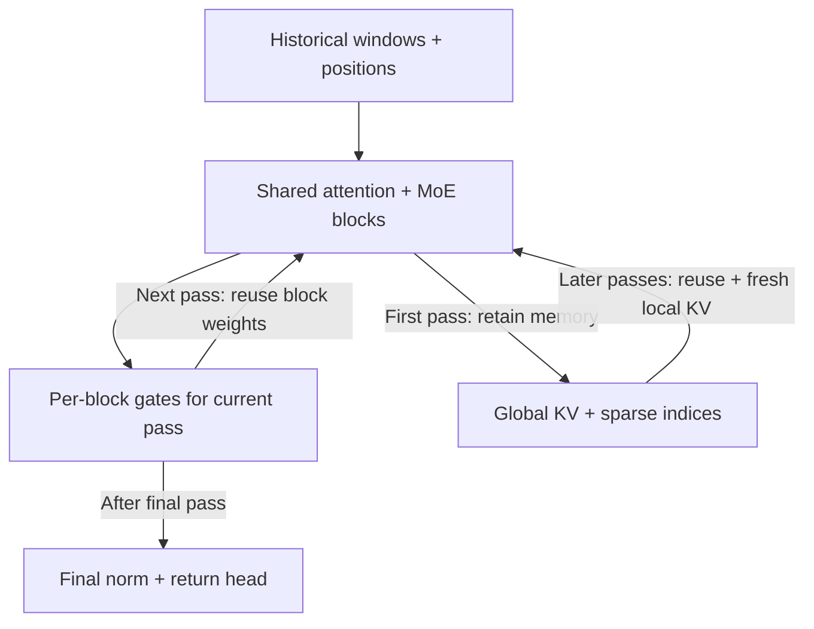

# GLM-5.4 and Qwen4: compact numeric research adaptations

These are **from-scratch, trainable time-series adaptations of disclosed architectural mechanisms**. They do not contain flagship model weights, language tokenizers, multimodal encoders, instruction tuning, or the capabilities produced by large-scale pretraining. A compact model inheriting an architectural idea does not inherit the source model's benchmark performance.

Source descriptions were checked on 27 November 2026:

- [Z.ai: GLM-5.4](https://z.ai/blog/glm-5.4?lang=en).
- [Qwen: Qwen4-Max](https://qwen.ai/blog?id=qwen4-max).
- [Qwen's released architectural precursor, Qwen3.8-Flash-Next](https://github.com/QwenLM/Qwen3.8-Flash-Next).
- [Transformers Qwen4-Exp documentation](https://github.com/huggingface/transformers/blob/main/docs/source/en/model_doc/qwen4_exp.md) and [implementation](https://github.com/huggingface/transformers/blob/main/src/transformers/models/qwen4_exp/modeling_qwen4_exp.py) corroborate the gated-delta, gated-residual, and block-indexing concepts; this experimental family is not treated as the complete Qwen4-Max release.

All code in these two modules was independently written for numeric inputs. No upstream implementation or model weights are vendored.

## GLM-5.4 adaptation: a loop Transformer

**`glm54_mini` is a loop Transformer.** Its sparse-attention and MoE Transformer blocks are stored once in `GLMMiniEncoder.blocks` and reused across refinement passes within each forward call. With the default two shared blocks and two passes, execution visits block 0, block 1, then the same block 0 and block 1 again. Attention, normalization, and expert weights are shared across passes; each block has separate learned token gates for each pass.



The diagram summarizes the loop; each gate is applied inside its corresponding block. Each block also keeps its own memory, and all memories are reset at the start of the next forward call.

The official GLM-5.4 description identifies a loop over shared layers, independent per-pass token gates, reuse of first-pass sparse global KV plus new local KV, and reuse of sparse indices. It describes two passes over 28 base-model layers. The exact flagship implementation and training recipe are not reproduced here.

| Mechanism | Local implementation |
| --- | --- |
| Repeated shared computation | `GLMMiniEncoder.blocks` is a single set of attention/expert blocks called repeatedly. Two passes are the default. |
| Progressive gated updates | Each block/pass has a separate scalar sigmoid gate per token, computed from the current state and candidate attention/MoE update. The residual update is `x + gate * dropout(candidate)`. Gate bias starts at -1.5 for pass one and 0 for later passes; gate values are learned and need not increase monotonically. |
| Global KV reuse | Each block retains its first-pass keys/values and selected positions for the duration of a forward pass. Later passes reuse them. |
| Independent local KV | Later passes append newly projected KV from a trailing window. The same position can occur in both streams with different representations. |
| Index reuse | The lightweight indexer runs once per shared block, regardless of pass count. The later passes do not rerun selection. |
| Sparse feed-forward experts | Four compact SwiGLU experts use actual top-2 token dispatch, alongside a shared expert. Expert count/width and the balancing loss are local research choices. |

The indexer uses causal token scores, and only selected KV are used by the main attention operation. Selected index scores also affect the attention logits so the indexer receives learning signal from forecasting. This is an explicit local adaptation rather than a claim about GLM's precise indexer training objective. The lightweight index computation itself is dense and quadratic in this reference implementation; there are no flagship-scale latency or memory-efficiency claims.

Cached global keys, values, and selected index scores retain their computation graphs, so later-pass losses train the first-pass memory as well as the shared projections and pass-specific gates. Later passes project fresh local KV from their current hidden states using the same shared projection weights. Discrete top-k positions are reused, while their selected scores remain differentiable.

| Setting | Constructor defaults | Shipped YAML / benchmark |
| --- | --- | --- |
| Numeric input features | 157 | 157 |
| Width / attention heads | 64 / 4 | 32 / 4 |
| Distinct shared blocks (`num_layers`) | 2 | 2 |
| Refinement passes (`loop_steps`) | 2 | 2 |
| Block applications per forward | 4 | 4 |
| Global selections / trailing local window | 8 / 4 | 8 / 4 |
| Routed experts / active experts per token | 4 / 2, plus one shared expert | 4 / 2, plus one shared expert |
| Trainable parameters | **169,221** | **45,189** |

`num_layers` counts distinct shared blocks. Increasing `loop_steps` adds pass-specific gates and computation without copying the body. The [shipped configuration](../../configs/glm54_mini.yaml) uses 32-session windows, dropout 0.1, and a maximum of 12 training epochs. Pass count and other architecture-specific options can be set under `model.params.architecture_kwargs`, for example `loop_steps: 3`.

## Qwen4 adaptation

The official Qwen4 description identifies a three-to-one Gated DeltaNet/Qwen Sparse Attention pattern, four residual branches controlled by read/write gates, sparse experts, and lexical N-gram lookup. The local model retains the numerical mechanisms below and explicitly substitutes for the lexical component.

| Mechanism | Local implementation |
| --- | --- |
| Gated DeltaNet | An explicit fixed-size recurrent state decays, predicts the value associated with a key, and applies a gated delta-rule correction. Queries read the updated state. |
| Hybrid layer schedule | Every group contains three gated-delta mixers and one block-sparse attention mixer. |
| Micro-block attention selection | A lightweight indexer scores completed historical blocks, selects top blocks, and retains the current block directly. Future positions and missing observations are masked. |
| Four gated residual streams | Four persistent streams are read using dynamic elementwise softmax gates and updated through dynamic sigmoid write gates around both mixing and expert sublayers. |
| Sparse experts | Four small SwiGLU experts with top-2 dispatch; no language vocabulary head. Expert widths and router balancing are research choices. |
| Local context representation | A causal depthwise numeric convolution enters at the second layer. This **replaces**, and is not described as reproducing, a categorical token N-gram embedding table. |

The recurrent update is implemented directly. With normalized keys/queries, a decay `a`, and write gate `b`, it computes a decayed state, subtracts the value predicted from the current key, and writes the residual back as a rank-one correction:

```text
S_decay = a * S_previous
error = value - key @ S_decay
S = S_decay + b * outer(key, error)
output = query @ S
```

Missing observations neither write nor decay the state. The main sparse attention actually gathers the selected tokens; it does not simply apply a branded name to dense attention. At an incomplete final block it retains only real observations, without duplicating the last token. Indexing remains a straightforward reference implementation, not a fused serving kernel.

Default dimensions are 157 inputs, width 64, four heads, and two hybrid groups: **462,578 parameters**. Here `num_layers` counts groups, so the default means eight mixers; use `num_layers=1` for a smaller four-mixer experiment. Parameter count and compute are consequently different from an equal numerical layer setting in GLM. Comparisons should report these differences rather than imply an equal-compute experiment.

## Data and training interface

Both encoders accept `features[batch,time,feature]` and a Boolean `padding[batch,time]` mask, and return one score per example, including a one-example batch. The surrounding Qlib adapter fits feature/target transformations on training data only and converts normalized neural outputs back to return units.

`aux_loss` exposes a scalar router-balancing term after each forward pass. It must be explicitly weighted in the training objective; it is not a forecast-error metric. `forward_features` is available for causality checks. Every hidden position is causal even though the application only consumes the final position of an already historical window.

## Behavioral verification

`tests/test_glm_qwen.py` tests actual mechanics: shared body calls versus extra pass gates; one indexer call per shared block; preserved first-pass KV; a three-to-one hybrid schedule; finite singleton/all-missing behavior; missing-state skipping; sparse attention's causal indices and partial-block length; trainable routers, experts, delta gates, and residual gates; loss reduction on a known numeric target; state-dict replay; and future perturbations leaving earlier hidden states unchanged.

These checks establish implementation behavior. Financial out-of-sample performance must be measured separately by the repository's chronological benchmark.
