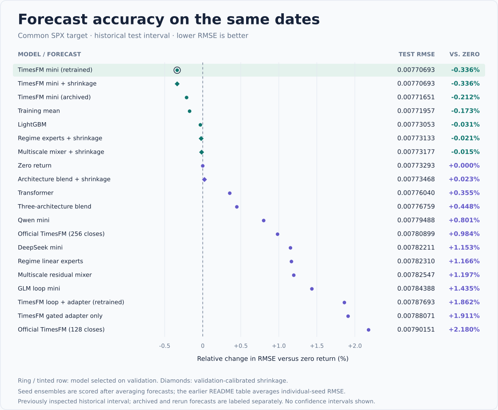
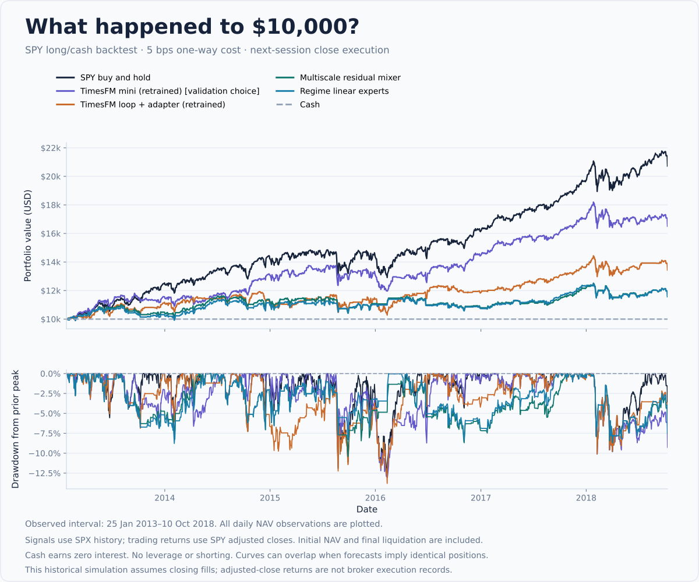
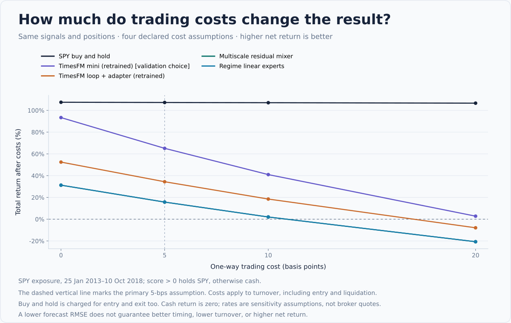

# Common-period forecasting and SPY backtest

**Completed 27 November 2026, Hong Kong time.** The fine-tuned TimesFM loop
improves slightly on the frozen official checkpoint, but does not beat the
small TimesFM model or a zero-return forecast. The new three-seed mini ensemble
has the lowest measured forecast error. SPY buy-and-hold earns more than every
learned-model strategy under the fixed primary trading policy. The two new
architectures do not outperform the mini baseline.

This report retains the unsuccessful candidates, distinguishes forecast error
from portfolio performance, and publishes the rows needed to reproduce both.
The historical test interval was already inspected before this work; these
results are exploratory follow-up research.

[All forecast and cost results](../reports/financial_research/comparison.csv)
· [Settings and provenance](../reports/financial_research/settings.json)
· [Aligned predictions](../reports/financial_research/predictions.csv)
· [Independent accounting audit](../reports/financial_research/independent_audit.json)

## Why validation RMSE was higher than 0.0077

The underlying SPX data and delayed-return definition did not change. Every
forecast ends its input at close `t` and predicts:

```text
target[t] = SPX_close[t+2] / SPX_close[t+1] - 1
```

The dates and sample coverage differ. A zero-return forecast measures the
root-mean-square magnitude of the target itself, making the period effect
directly visible.

| Evaluation | Prediction dates | Rows | Zero-return RMSE |
| --- | --- | ---: | ---: |
| Original TimesFM pilot validation sample | 2007-05-09–2013-01-18, sampled | 128 | 0.01589699 |
| Full validation | 2007-05-09–2013-01-18 | 1,436 | 0.01599491 |
| Common historical test | 2013-01-24–2018-10-08 | 1,438 | 0.00773293 |

The full-validation target RMS is **2.0684 times** the test target RMS. A
validation error near 0.016 and a test error near 0.0077 therefore cannot be
compared as if they measured the same forecast problem on the same observations.
This scale difference does not itself prove that either model is good.

The shared scratch-model training interval is 1990-03-28–2007-05-04, containing
4,312 examples. Two actual trading sessions are purged at partition boundaries.
Feature and target normalization use training data only. The official-model
pilot uses its recorded 256 eligible training examples and 128 validation
examples, with a longer price-only context.

Provider fingerprint:
`7bb6bcfa19c770b7ec528a6f058cbde875d4d347041028db24398724a8af9d53`.
The source `^GSPC.csv` has 7,252 rows from 1990-01-02 through 2018-10-10.
All 1,438 test labels and identities match exactly across the original benchmark,
the new scratch campaign, and the official TimesFM comparison.

## TimesFM loop and adapter comparison

The three official-checkpoint variants below use **the same 128 observed closes,
same dates, and same targets**. They forecast the next two closes and convert
those outputs to the delayed return. The archived official replay using 256
closes remains separate because its context differs.

| Model | Full validation RMSE | Common test RMSE |
| --- | ---: | ---: |
| Zero return | 0.01599491 | 0.00773293 |
| Frozen official TimesFM 3, 128 closes | 0.01620599 | 0.00790151 |
| Loop + adapter, fresh same-recipe retrain | 0.01615178 | 0.00787693 |
| Parameter-matched gated adapter-only control | 0.01615656 | 0.00788071 |
| New TimesFM mini seed ensemble, 32-session factor windows | **0.01597558** | **0.00770693** |

The loop reduces test RMSE by **0.3111% relative to the frozen 128-close model**,
but remains **1.8621% worse than zero return**. Its difference from the
adapter-only control is only about 0.00000378 in RMSE. The original sampled
validation improvement did not extend to beating zero return on full validation.

The official model has 330,710,976 frozen parameters. Both trainable variants add
**21,761 gate/adapter parameters**, begin with identical new tensors, and use the
same sample records, seed 42, batch size four, AdamW settings, and three epochs.
Both selected epoch two from epochs zero through three. Those selections were
frozen before full validation and test scoring.

The loop reuses layers 8–11, producing **24 layer evaluations with 20 original
layer objects**. The control uses 20 evaluations. Its update is
`h + (1 + gate(h)) * adapter(h)`, while the loop uses
`h + gate(h) * (F_shared(h) - h) + adapter(h)`. Parameter count is matched, but
the gate's role and computation differ. This is a useful control, not an exact
compute-matched causal ablation. One seed and this small gap cannot establish
that looping itself improves generalization.

### The original adapter was not recovered exactly

The original local adapter was unavailable after the temporary environment
reset. The original fixed recipe was run once using matching data, sample
records, checkpoint bytes, training source, seed, and recorded package versions.
The strict numerical recovery check failed slightly and stopped before test
evaluation. Its failure record is retained. The same saved retrain was then
used for the comparison, without another training attempt.

The selected epoch remained two. Sampled-validation RMSE changed from
**0.0158700501993** to **0.0158702974238**; the maximum difference across the
128 selected forecast scores was **8.4155e-6**. The original adapter's exact
test performance is therefore unknown. The new score and backtest describe a
**fresh same-recipe retrain**, recorded as `numerical_replication_only`.

The scratch mini also produced different training trajectories when rerun with
the recorded settings. A separate audit found identical prepared data, initial
parameters, first batch and first forward output between the two current
training entry points. It did not establish the cause of the original-versus-new
trajectory difference. Archived and newly trained forecasts remain separate;
the report does not attribute the drift to a proven hardware cause.

[TimesFM protocol and recovery checks](timesfm-loop-validation.md)
· [Full comparison manifest](../reports/timesfm_comparison/comparison.json)
· [Strict recovery failure](../reports/timesfm_comparison/strict_recovery_attempt.json)
· [Scratch reproduction audit](../reports/model_research/reproduction_audit.json)

## Two new architectures and one fixed selection protocol

The candidates were designed to test whether small, financially motivated
structures help on this noisy daily-return task. Both are randomly initialized
local implementations using the existing Qlib factor pipeline.

| Candidate | Parameters per seed | Hypothesis |
| --- | ---: | --- |
| Multiscale residual mixer | 14,395 | Mix trailing 1/4/16/32-session factor summaries; combine a linear forecast with a small gated causal convolution/MLP residual. |
| Regime-gated linear experts | 3,266 | Let a small gate combine three linear experts using historical amplitude, trend, dispersion and coverage descriptors. |
| TimesFM mini baseline | 30,157 | Reuse the existing temporal/variate patch model under the same campaign settings. |

The expert descriptors summarize normalized features; they are not an independently
estimated return-volatility process or identified economic regimes. The models'
zero-initialized output heads initially predict the training-label mean after
inverse normalization. Zero return and the training mean are both retained as
controls. Architectural motivation and exact omissions are documented in the
[new-model notes](architectures/financial.md), with primary references to
TSMixer, TimeMixer, LTSF-Linear and adaptive mixtures of experts.

The campaign contains exactly **nine training runs**: three models times seeds
**7, 42 and 2026**. Neural width is 32, the window is 32 sessions, the maximum
budget is 12 epochs, and early stopping allows four non-improving epochs.
All seeds are retained and their predictions are averaged equally. An additional
equal-weight blend averages the three architecture ensembles.

Before generating test predictions, validation selected checkpoints and one
forecast-shrinkage coefficient from the fixed grid `{0, 0.25, 0.5, 0.75, 1}`:

```text
calibrated_forecast = training_mean + gamma * (forecast - training_mean)
```

This regularizes forecasts toward an estimate learned from training data.
The training mean is **0.00039403997569**. Validation selected gamma one for the
mini, 0.25 for each new model, and 0.5 for the architecture blend. The mini
ensemble had the lowest validation RMSE, so its calibrated duplicate is
unchanged. The saved selection file precedes the first test prediction.

| New campaign forecast | Full validation RMSE | Test RMSE |
| --- | ---: | ---: |
| Training mean | 0.01599657 | 0.00771957 |
| **TimesFM mini ensemble, validation choice** | **0.01597558** | **0.00770693** |
| Multiscale residual mixer ensemble | 0.01603426 | 0.00782547 |
| Mixer + validation-selected shrinkage | 0.01599384 | 0.00773177 |
| Regime linear experts ensemble | 0.01603370 | 0.00782310 |
| Experts + validation-selected shrinkage | 0.01599381 | 0.00773133 |
| Equal-weight architecture blend | 0.01599942 | 0.00776759 |
| Architecture blend + shrinkage | 0.01599007 | 0.00773468 |

**Neither new architecture beats the mini baseline.** Shrinkage rescues much of
their excess error, but neither calibrated candidate beats the training-mean
control on test. The architecture blend also fails to beat the mini alone.
The useful point improvement in this campaign comes from averaging mini
forecasts, not from a demonstrated superior new architecture.

[Declared protocol and source hashes](../reports/model_research/protocol.json)
· [Selection made before test prediction](../reports/model_research/selection.json)
· [All nine runs and learning curves](../reports/model_research/metrics.json)
· [Validation predictions](../reports/model_research/validation_predictions.csv)

## Forecast ranking and uncertainty



The original README's **0.00772459** is the mean of three individual TimesFM mini
seed RMSEs. Averaging those original forecasts first produces an archived
ensemble RMSE of **0.00771651**. The newly trained seed ensemble scores
**0.00770693**, a **0.124% relative reduction** from that archived ensemble and
**0.336% below zero return**. These quantities must not be interchanged.

A paired circular moving-block bootstrap uses the same sampled sessions for
both forecasts, 20-session blocks, 2,000 draws, and seed 913. For the new versus
archived mini ensemble, the observed RMSE difference is **−0.000009583**, with a
95% interval **[−0.000028299, +0.000008299]**. Negative favors the new ensemble.
The interval includes zero. This resampling check does not account for the
entire research-selection process and cannot turn an already inspected period
into a fresh holdout.

All archived models in the new chart also average their three seed forecasts
before scoring. Their ensemble validation predictions were not archived, so
the new table leaves those validation cells blank rather than substituting
the mean of seed-level validation metrics.

[Every forecast metric](../reports/financial_research/forecast_metrics.csv)
· [Paired intervals against the archived mini ensemble](../reports/financial_research/paired_intervals.json)

## Historical SPY backtest

Signals are forecasts of **SPX** returns. Trading returns use **SPY**, an ETF
designed to track the S&P 500; the index itself is not treated as a tradable
asset. See [State Street's SPY description](https://www.ssga.com/us/en/individual/etfs/state-street-spdr-sp-500-etf-trust-spy).
All strategies use the same 1,438 forecast dates.

| Assumption | Fixed choice |
| --- | --- |
| Position | One unit of portfolio exposure to SPY when forecast > 0; otherwise cash |
| Signal availability | After close `t` |
| Execution | Close `t+1`, then earn the close `t+1` to close `t+2` return |
| Invested interval | 2013-01-25–2018-10-10; final position liquidated |
| Price basis | SPY dividend/split-adjusted closes as a total-return proxy |
| Primary cost | 5 basis points of traded notional each way |
| Cost sensitivity | 0, 5, 10 and 20 basis points each way |
| Cash, shorting, leverage | Zero cash interest; no shorts or leverage |
| Taxes | Excluded |
| Selection of trading rule | Fixed before backtest; no test-fitted threshold or holding period |

Adjusted closes are not executable fill quotes. The cost assumptions combine
friction into one proportional rate and are not a reconstruction of historical
broker fees, spreads, market impact or closing-auction fills. SPX prediction
error and SPY portfolio returns measure different outcomes.

The accounting is self-financing. A purchase spends cash on both notional and
its fee, giving an invested fraction `1 / (1 + cost_rate)`. A sale returns
`1 - cost_rate` of sale notional. Staying in an unchanged position incurs no
trade cost. The initial buy and final liquidation are charged for buy-and-hold
as well. Drawdown includes the initial NAV of one. CAGR uses actual elapsed
calendar days; volatility and the zero-cash-rate Sharpe use 252 sessions.

### All primary-cost results

Scratch architecture rows are equal-weight three-seed forecast ensembles.
Trades count purchases plus sales, including terminal liquidation. The unchanged
mini-shrinkage duplicate is omitted from this table but retained in the CSV.

| Forecast / strategy | Test RMSE | Net return | CAGR | Sharpe | Max drawdown | Trades |
| --- | ---: | ---: | ---: | ---: | ---: | ---: |
| Zero return | 0.00773293 | 0.00% | 0.00% | — | 0.00% | 0 |
| Training mean | 0.00771957 | 107.23% | 13.62% | 1.11 | −13.02% | 2 |
| LightGBM | 0.00773053 | 92.13% | 12.13% | 1.04 | −16.80% | 84 |
| Transformer | 0.00776040 | 13.57% | 2.25% | 0.30 | −10.94% | 292 |
| DeepSeek mini | 0.00782211 | 18.72% | 3.05% | 0.34 | −16.09% | 346 |
| GLM loop mini | 0.00784388 | 13.62% | 2.26% | 0.29 | −9.26% | 310 |
| Qwen mini | 0.00779488 | 22.64% | 3.64% | 0.43 | −10.97% | 314 |
| TimesFM mini, archived | 0.00771651 | 81.35% | 11.00% | 0.95 | −14.76% | 148 |
| Official TimesFM, 256 closes | 0.00780899 | 87.78% | 11.68% | 1.04 | −12.73% | 184 |
| **TimesFM mini, retrained** | **0.00770693** | **65.10%** | **9.19%** | **0.84** | **−13.03%** | **316** |
| Multiscale residual mixer | 0.00782547 | 15.69% | 2.59% | 0.32 | −10.42% | 252 |
| Mixer + shrinkage | 0.00773177 | 69.01% | 9.63% | 0.87 | −12.61% | 84 |
| Regime linear experts | 0.00782310 | 15.73% | 2.59% | 0.32 | −8.78% | 252 |
| Experts + shrinkage | 0.00773133 | 74.88% | 10.29% | 0.92 | −12.61% | 84 |
| Three-architecture blend | 0.00776759 | 27.68% | 4.38% | 0.48 | −11.98% | 244 |
| Architecture blend + shrinkage | 0.00773468 | 64.64% | 9.13% | 0.86 | −11.48% | 174 |
| Official TimesFM, 128 closes | 0.00790151 | 35.38% | 5.45% | 0.53 | −13.85% | 228 |
| TimesFM loop + adapter, retrained | 0.00787693 | 34.40% | 5.32% | 0.53 | −13.79% | 252 |
| TimesFM gated adapter only | 0.00788071 | 33.86% | 5.24% | 0.52 | −13.57% | 252 |
| Cash | — | 0.00% | 0.00% | — | 0.00% | 0 |
| **SPY buy-and-hold** | — | **107.23%** | **13.62%** | **1.11** | **−13.02%** | **2** |

The positive training-mean forecast is always long and therefore exactly matches
buy-and-hold. It is a useful control: constant market exposure produces a high
return without timing skill. Some strategies show a smaller drawdown partly
because they spend more time in cash; that alone does not establish superior
risk-adjusted skill.



The newly trained mini has the best RMSE but trades **316 times**, versus **148**
for the archived mini. Their gross returns are 93.36% and 95.28%; at 5 bps they
fall to 65.10% and 81.35%. Lower prediction error did not translate into a better
sign strategy. The loop likewise has slightly better RMSE than the frozen
128-close model, yet a lower primary-cost return: 34.40% versus 35.38%.



At 20 bps each way, the new mini's return drops to 2.78%, the loop's to −7.90%,
and the two raw new architectures to approximately −20.7%. The policy and
forecasts remain unchanged in each scenario. The chart shows the fixed focus
strategies, while the CSV retains all **22 strategies/controls × four costs**.

### Price provenance and independent checks

The public Yahoo Finance chart response supplied 3,218 SPY sessions from
2006-01-03 through 2018-10-12, with 51 dividend events and no split events.
Timestamps were mapped to New York session dates; missing observations were
rejected and no values were filled. Adjusted closes already incorporate the
source's dividend/split adjustments; dividends are not added a second time.
See [Yahoo's adjustment definition](https://help.yahoo.com/kb/SLN28256.html).

The [saved settings](../reports/financial_research/settings.json) include the
exact request URL, download time and hashes. The original raw response SHA-256
is `40574887f3b2a59baf29b1f0a06a56695d0eb194e96b47002e70e27c28071701`.
The published [price window](../reports/financial_research/spy_prices.csv)
contains the exact 1,440 observations needed for offline replay; its row subset
has a different file hash from the complete downloaded source CSV.

An independent cash-and-shares simulation, without importing the project's
accounting implementation, recomputed all **88 metric rows**. Maximum numerical
discrepancies were about **2e-14** for both metrics and primary equity curves.
Every published adjusted close matched the raw source. Replaying only the
published forecasts and prices reproduced all metric rows exactly and generated
126,544 ledger rows. The audit also checked every common label and source hash.

## Reproduce the results

Start with the [beginner installation guide](getting-started.md). Commands below
run from the repository root with its environment activated. Choose a new output
directory for each run; existing results are not silently overwritten.

### Offline backtest from the published evidence

```bash
fts backtest --predictions reports/financial_research/predictions.csv --spy-csv reports/financial_research/spy_prices.csv --output runs/my-backtest
```

Open `metrics.csv`, `ledger.csv` and `settings.json` in that output directory.
No training, checkpoint download or online price lookup is needed. The independent
accounting check also works offline:

```bash
python scripts/audit_financial_research.py
```

Rebuild the aggregate comparison from the archived experiments:

```bash
fts compare-research --scratch reports/model_research --timesfm reports/timesfm_comparison --spy-csv reports/financial_research/spy_prices.csv --output runs/rebuilt-research
```

### Repeat the scratch campaign

```bash
fts import-csv --csv "^GSPC.csv" --symbol SPX --provider .data/my-spx
fts research --provider .data/my-spx --output runs/my-research --seeds 7 42 2026 --epochs 12 --device cpu
```

This repeats nine training runs and saves all selected states locally. It locks
validation choices before generating test forecasts. Fixed seeds do not promise
bit-identical results across environments; the recorded experiment uses Python
3.12.14, PyTorch 2.15.0+cpu, Qlib 0.9.7, NumPy 1.26.4 and pandas 2.3.3.

### Repeat the official TimesFM comparison

Follow the [pinned checkpoint setup](architectures/timesfm.md#timesfm3_pretrained)
and [comparison/recovery instructions](timesfm-loop-validation.md#reproduce-the-pilot).
The command is:

```bash
fts compare-timesfm --provider .data/my-spx --checkpoint .data/timesfm3-checkpoint --output runs/my-timesfm-comparison --original-evidence reports/timesfm_loop_pilot
```

Strict recovery intentionally stops if the new run differs from the original
pilot. Inspect the saved discrepancy before explicitly resuming a numerical
replication. This keeps a retrain distinct from recovery; it is not an automatic
way to relax evidence requirements. No test result changes checkpoint selection.

The official checkpoint and derivatives remain subject to Google's
[noncommercial, nonproduction license](https://huggingface.co/google/timesfm-3.0-pytorch/blob/43046b85ec22d584a13f8098c2ed39c889e129c2/LICENSE).
Only original code and numerical/provenance reports are published here; no
checkpoint or learned adapter tensor is included. Pretraining overlap with
the historical test prices is unknown.

### Regenerate the figures

The committed SVGs were generated with Matplotlib 3.10.8 and visually inspected.
To reproduce that rendering environment:

```bash
python -m pip install "matplotlib==3.10.8"
python scripts/render_financial_research.py
```

The renderer reads the published numerical report and writes three self-contained
SVGs. Optional `--preview-dir` exports PNGs for inspection. No image-generation
model is used for the data figures.

## What these results justify next

Keep the small TimesFM ensemble as the forecast baseline and buy-and-hold as
the portfolio hurdle. The current evidence does not justify replacing them
with either new architecture or the looped official checkpoint.

The next useful experiments would target the failure exposed here: forecasts
near zero create frequent position changes, and extra representational capacity
has not improved this small sample. Candidate ideas include a validation-selected
transaction-cost-aware position head, an uncertainty-based no-trade region, and
cross-asset residual forecasting with a simple market-exposure baseline. They
are hypotheses, not measured improvements in this report.

Those experiments need multiple chronological walk-forward folds and a genuinely
uninspected final interval before making another performance claim. Selection
should happen within each fold, with costs and benchmarks fixed in advance.
Repeatedly trying architectures on this same historical test set would not
establish that a future strategy will outperform.
