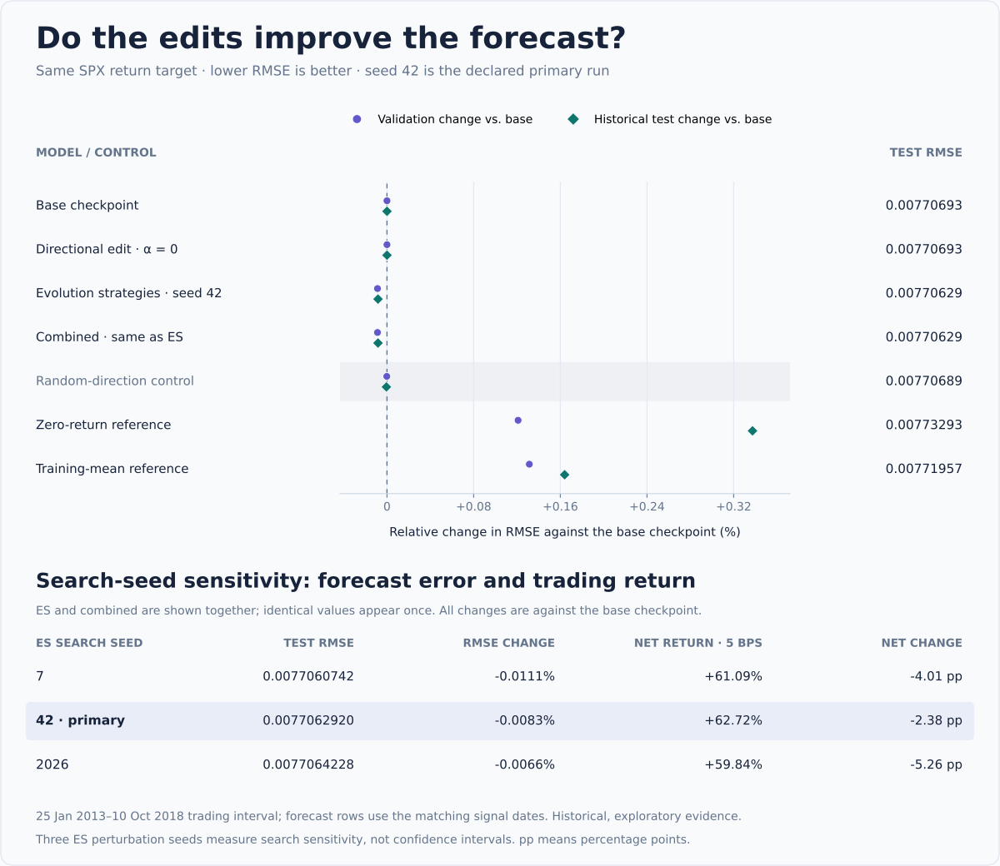
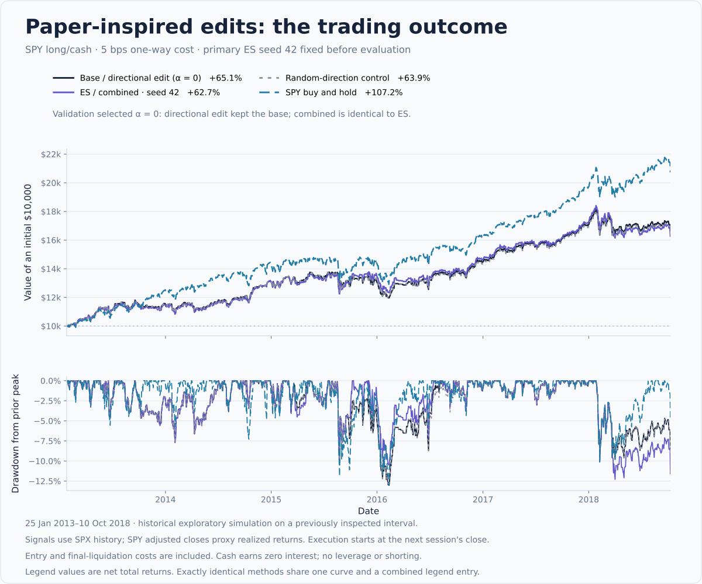
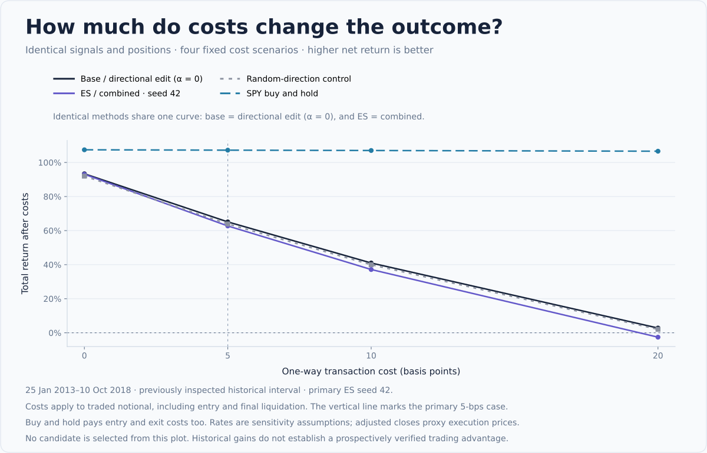

# Evolution strategies and directional weight editing

This experiment applies two paper-inspired post-training ideas to the **existing
validation-selected TimesFM mini ensemble**. The incumbent contains three
independently trained 30,157-parameter models, with seeds 7, 42, and 2026. Their
forecasts are averaged equally. The joint ES search covers all **90,471
parameters**. No official TimesFM checkpoint is used in this experiment.

The forecast target, data, execution timing, and transaction costs are identical
to the [existing financial comparison](financial-research.md). This is a follow-up
on an already inspected historical interval. It is not a fresh holdout or a
claim of current trading profitability.

## Result: a tiny forecasting change, lower trading returns

**Neither paper-inspired method earns a trading replacement recommendation.**
The declared ES seed reduces test RMSE from **0.00770693 to 0.00770629**, a
relative improvement of **0.0083%**. At 5 basis points each way, net return falls
from **65.10% to 62.72%**. The paired 95% interval for the RMSE difference is
**[-0.000002341, +0.000000669]**, which includes zero.

| Primary comparison | Validation RMSE | Test RMSE | Net return, 5 bps | Sharpe | Max drawdown | Trades |
| --- | ---: | ---: | ---: | ---: | ---: | ---: |
| Base mini ensemble | 0.01597558 | 0.00770693 | 65.10% | 0.845 | -13.03% | 316 |
| Directional edit | 0.01597558 | 0.00770693 | 65.10% | 0.845 | -13.03% | 316 |
| **ES, declared seed 42** | **0.01597418** | **0.00770629** | **62.72%** | **0.829** | **-12.29%** | **342** |
| Directional edit then ES, seed 42 | 0.01597418 | 0.00770629 | 62.72% | 0.829 | -12.29% | 342 |
| Random-direction control | 0.01597555 | 0.00770689 | 63.91% | 0.833 | -13.03% | 316 |
| SPY buy-and-hold | — | — | 107.23% | 1.106 | -13.02% | 2 |

Validation selected **alpha zero** for the diagnosed edit. Therefore the edit
arm is exactly the base, and the combined arm is exactly ES; the search
histories, saved weight hashes, and forecasts agree. The experiment provides
no evidence of synergy between the two mechanisms. It also does not exclude
a different jointly selected, nonzero edit-plus-ES procedure; that procedure
was not tested here. The random control selected alpha 0.1 but produced only
a negligible RMSE change and a lower trading return.



### Optimizer seed stability

| Optimizer seed | Selected generation | Test RMSE | Net return, 5 bps |
| --- | ---: | ---: | ---: |
| 7 | 8 | 0.00770607 | 61.09% |
| **42, predeclared primary** | **8** | **0.00770629** | **62.72%** |
| 2026 | 3 | 0.00770642 | 59.84% |

All three have slightly lower historical RMSE and lower net return than the
base. Their paired RMSE intervals all include zero. Seed 7's lower test RMSE
does not replace the declared seed 42. Seeds describe optimization variation
on one dataset; they are not independent market samples.



The ES primary forecast trades 342 times instead of 316. Small changes around
zero can alter a binary trading position even when squared error barely changes.
The fixed trading rule therefore exposes a separate failure: optimizing a
forecast loss does not optimize market exposure, turnover, or net portfolio
return. The slightly smaller drawdown does not offset the lack of demonstrated
forecast significance and the lower return/Sharpe in this screen.



The useful next hypothesis is a transaction-cost-aware position policy with a
no-trade region or slower rebalancing. Such a policy would need its own
development-only selection and a new chronological evaluation interval. It
is not a result of the present experiment, and the existing mini and
buy-and-hold controls remain the comparison standards.

## Ideas and their scope

[Evolution Strategies at Scale](https://arxiv.org/html/2509.24372v3) evaluates
Gaussian perturbations of model weights and combines them using normalized
rewards. Our implementation uses that full-parameter, gradient-free mechanism
with return-forecasting loss. It uses no mirrored sampling, rank transformation,
or Adam. The conventional update retains the explicit `1 / sigma` factor;
the paper absorbs that factor into its learning rate.

[Language Models Can Rewrite Their Own Weights](https://arxiv.org/html/2611.21885v2)
studies a reasoning LLM that diagnoses and edits its own weights. We borrow a
rank-one directional attenuation operation. In this repository, external code
diagnoses a direction in a small numeric model. This is **directional weight
editing**, not a reproduction of an LLM reasoning about itself.

For a unit direction `u`, the edit is:

```text
W_edited = W - alpha * u * (u.T @ W)
b_edited = b - alpha * u * (u.T @ b)  # when the layer has a bias
```

The selected layer is the final feedforward output projection in the second
mixing block, `layers.1.ff.3`. It is an internal projection, not the scalar
forecast output. No new model parameters or inference passes are introduced.

## Fixed comparison

| Arm | Initialization and selection |
| --- | --- |
| Base | Saved three-seed mini ensemble, with no new fitting. |
| Directional edit | Training-derived error direction; one common attenuation strength chosen on validation. |
| ES | Full-parameter Gaussian ES from the base; choose a generation using validation only. |
| Directional edit then ES | The validation-selected directional edit followed by the same ES budget and noise seeds. |
| Random-direction control | Independent random directions with the same attenuation grid and validation selection. |

The attenuation grid is `{0, 0.01, 0.025, 0.05, 0.10}`. Including zero allows the
original model to reject an unhelpful edit. Ties retain the lower attenuation.
The combined arm uses this selected edit; if validation selects zero, it becomes
identical to ES alone. That equivalence must be reported rather than counted as
independent confirmation of the combined method.

ES uses **12 proposals per generation, eight generations, sigma 0.001, and a
learning rate of 1e-6**. Three optimizer seeds, 7, 42, and 2026, are retained for
stability checks. **Seed 42 is the declared primary comparison**, regardless of
which seed has the best test result. The two ES arms therefore run six searches
and score 576 perturbed models. Generation zero is eligible; individual proposal
models are never selected on validation. Weights and buffers are restored from
exact saved values between proposals.

Both ES fitting and directional diagnosis use the same **512 evenly spaced
training observations**, from 1990-04-27 through 2007-05-04. They are a bounded
subset of the original 4,312-row training segment, not a new holdout. ES reward
is negative mean squared error in training-standardized return units.

For directional diagnosis, each example's internal output is averaged across
variates and forecast-patch positions. The direction contrasts the highest and
lowest residual-loss quartiles. Diagnostic loss is divided by the square of a
20-session past realized-return volatility estimate, floored at 0.001. With the
delayed target, `y[t-2]` is known at close `t`, so the volatility window uses
`labels.shift(2).rolling(20)` without future observations. This contrast is a
heuristic; it does not establish that the direction causes bad forecasts.

The full 1,436-row validation interval, 2007-05-09–2013-01-18, selects strengths
and generations. The base checkpoints also used that validation period, so it
is an adaptively reused development set. The selected weights, hashes, and
primary seed are saved before loading test labels for scoring. All 1,438
historical test dates, 2013-01-24–2018-10-08, then receive one frozen forecast
from every declared arm.

Zero return and the original training-label mean remain controls. Portfolio
evaluation keeps the same fixed positive-score long/cash policy and **0, 5, 10,
and 20 basis points each way**. ES optimizes forecasting loss in this experiment;
it does not optimize Sharpe, profit, a threshold, or trading costs.

## Reproduce

Follow the [installation guide](getting-started.md) and import the bundled data:

```bash
fts import-csv --csv "^GSPC.csv" --symbol SPX --provider .data/my-spx
fts research --provider .data/my-spx --output runs/my-research --seeds 7 42 2026 --epochs 12 --device cpu
fts research-papers --provider .data/my-spx --base-runs runs/my-research --spy-csv reports/financial_research/spy_prices.csv --output runs/my-paper-experiment
```

The last command requires the saved states from the scratch campaign, including
its validation-selected mini incumbent. It checks the provider fingerprint and
replays the incumbent's saved validation predictions before searching. If a
new scratch run selects another architecture, this fixed mini experiment stops
rather than silently redefining the incumbent. CPU is used for this bounded
screen. Fixed seeds do not guarantee identical training results across systems.

To replay the published trading results without fitting models:

```bash
fts backtest --predictions reports/paper_posttraining/predictions.csv --spy-csv reports/paper_posttraining/spy_prices.csv --output runs/replayed-paper-backtest
python scripts/audit_posttraining.py --evidence reports/paper_posttraining
```

The published checkpoint directory contains the compact, independently trained
mini states used in this experiment. It contains no Google pretrained weights
or official TimesFM adapter. After importing the bundled CSV, reproduce their
saved forecasts without training:

```bash
python scripts/replay_posttraining.py --provider .data/my-spx --report reports/paper_posttraining
```

To regenerate the figures:

```bash
python -m pip install "matplotlib==3.10.8"
python scripts/render_posttraining.py --preview-dir runs/paper-figure-previews
```

## Evidence

- [Registered protocol](../reports/paper_posttraining/protocol.json), with input and source hashes.
- [Training-only diagnostic observations](../reports/paper_posttraining/fit_samples.json).
- [Directions and random controls](../reports/paper_posttraining/directions.json).
- [Every generation and proposal reward](../reports/paper_posttraining/search_history.json).
- [Selection frozen before test](../reports/paper_posttraining/selection.json).
- [Validation predictions](../reports/paper_posttraining/validation_predictions.csv) and [test predictions](../reports/paper_posttraining/predictions.csv).
- [Forecast metrics](../reports/paper_posttraining/metrics.csv), [all portfolio/cost scenarios](../reports/paper_posttraining/backtest_metrics.csv), and [equity observations](../reports/paper_posttraining/equity.csv).
- [Paired block intervals](../reports/paper_posttraining/paired_intervals.json) and [fixed calendar subperiods](../reports/paper_posttraining/subperiod_metrics.csv).
- [Independent audit](../reports/paper_posttraining/independent_audit.json).
- [Offline checkpoint inference replay](../reports/paper_posttraining/inference_replay.json).

The independent cash/share replay verifies all **52 strategy/cost scenarios**
and all **18,694 primary-cost ledger rows**, with maximum portfolio-metric
discrepancy below 2.5e-14. It also checks all saved checkpoint tensor hashes,
forecast metrics, edit selection, ES generation selection, and the unchanged
pretest selection hash. The original executed source is preserved under
`source/` and matches the registered hashes. Subsequent runner changes add
input-identity and empty-output-directory guards; they do not change the
recorded experiment or its selections.

A separate inference replay loads all nine saved mini checkpoints, verifies
their tensor hashes and training normalization, and recomputes both prediction
partitions. Its maximum absolute discrepancy is **0.0** across all 1,436
validation and 1,438 test rows per model. Five distinct weight states remain
after deduplicating the alpha-zero and combined aliases. This check performs
no neural-network fitting or weight updates.

The paired intervals resample common 20-session time blocks for both models,
using 2,000 draws and seed 913. They are conditional historical diagnostics,
not corrections for all prior and current model searches. The two-year calendar
subperiods are fixed-model breakdowns, not rolling retraining or walk-forward
cross-validation. A prospective superiority claim still requires a new interval
and selection nested inside chronological folds.
