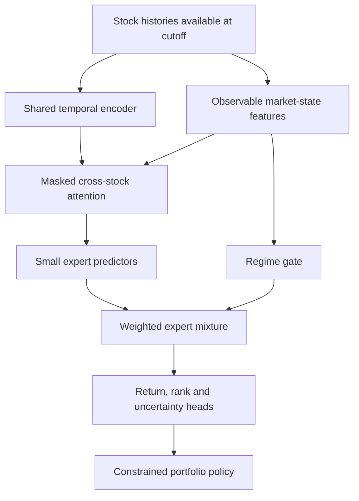

# Production roadmap

**Updated 27 November 2026 (Hong Kong time). Status: proposed research and
engineering work, except for the completed foundation identified below.**

The goal is a reliable daily financial-DL research and inference system with
defensible model selection, reproducible artifacts, realistic portfolio
accounting, and observable operation. Model quality and operational reliability
need separate evidence. A larger network or a successful backtest cannot by
itself establish readiness to trade.

This document turns the production recommendations into an ordered backlog.
The phase names are planning labels, not released package versions. The
proposed models, commands, services, and controls are not implemented merely
because they appear here. Each implementation should arrive in a focused PR
with its own acceptance evidence.

[Current evidence](#current-evidence-and-limitations) ·
[Priorities](#delivery-priorities) ·
[DL experiments](#deep-learning-experiments) ·
[Production gates](#promotion-gates) ·
[First PRs](#first-implementation-prs)

## Current evidence and limitations

The foundation is the completed [CSI300 campaign](chenditc-benchmark.md),
published in [PR #22](https://github.com/BenjiKCF/Neural-Net-with-Financial-Time-Series-Data/pull/22)
at revision `82e01ae343c4000c6ace622c9e4aa979c924005e`.

| Area | Verified state | Consequence for this roadmap |
| --- | --- | --- |
| Data | Pinned chenditc release `2026-11-26`, historical CSI300 membership, recorded archive and provider fingerprints. | Resolve “latest” once for a new campaign, then retain the immutable snapshot and manifest. |
| Completed comparison | Eight scratch setups and four official TimesFM setups; all 12 pass the independent artifact audit. | Preserve this campaign as a reference when changing data, labels, execution, or training. |
| Generalization | One seed, 42. The validation-selected Transformer has validation Rank IC `0.026105`, test Rank IC `-0.001884`, and simulated net return `-0.94%`. All 12 test RMSEs exceed the zero-return baseline. | Establish rolling and prospective evidence before promoting an architectural change. |
| Adaptation | The official loop and adapter-only runs both selected the unchanged epoch-0 state after their adaptation budget. | Increased depth or fine-tuning has not demonstrated an improvement in this campaign. |
| Portfolio accounting | Native Qlib replay and arithmetic reconcile, but terminated-series/corporate-action settlement remains unresolved. Transformer stale holdings are approximately 6.49% of final simulated NAV. | Correct instrument-lifecycle accounting is a production blocker; arithmetic consistency does not resolve valuation validity. |
| Reporting | Thirteen native Qlib figures, five README figures, and an offline interactive report are published with hashes. | Extend the existing exporter and evidence trail as new experiments are completed. |

Evidence: [protocol](../reports/chenditc_csi300/protocol.json),
[comparison](../reports/chenditc_csi300/comparison.json),
[audit](../reports/chenditc_csi300/audit.json),
[finalization receipt](../reports/chenditc_csi300/verification/finalization_receipt.json),
and [chart manifest](assets/qlib/manifest.json).
The [interpretation limits](chenditc-benchmark.md#interpretation-limits) apply:
snapshot reproducibility does not certify historical publication-time accuracy,
and official-checkpoint pretraining overlap remains unknown.

The 2025–2026 test results have now been inspected. Future work using that
interval is exploratory follow-up research. Reserve a genuinely uninspected
period, preferably prospective observations after protocol registration, for
the next final confirmation.

## Delivery priorities

| Priority / phase | Work package | Completion evidence |
| --- | --- | --- |
| P0 · V3.0 foundation | **Completed:** all-model evidence collection, independent audit, native Qlib gallery. **Open:** point-in-time data contracts and corporate-action accounting. | Source-backed lifecycle fixtures, reconciled positions/cash, and a new audited campaign for revised accounting. |
| P1 · V3.1 evaluation | Rolling evaluation, multiple seeds, stronger simple/Qlib baselines, IC and ranking objectives, realistic execution scenarios. | Every fold, seed, selection decision, failed trial, cost assumption, and paired comparison retained. |
| P2 · V3.2 architecture | MASTER-style comparator, cross-stock attention, regime-conditioned MoE, tree/neural ensemble, multi-horizon and uncertainty ablations. | Incremental value against controlled baselines with declared compute and tuning budgets. |
| P3 · V3.3 adaptation | Self-supervised pretraining and incremental learning, including a DoubleAdapt comparator. | Chronological pretraining/adaptation receipts, mature-label checks, and improvement over simple periodic retraining. |
| P1–P2 · V4.0 operation | Immutable inference bundles, registry, daily batch scheduling, monitoring, rollback, and shadow/paper operation. | Replay parity, restart/retry checks, observable failures, and a documented promotion decision. |

The operational work can start alongside V3.1. Deployment readiness does not
require finishing every research idea in V3.2 or V3.3.

### P0: data and portfolio truth

- [ ] **Define availability, not just observation dates.** Record the decision
  cutoff, source publication time or conservative lag, revision policy,
  adjustment convention, timezone/calendar, and historical eligibility for
  every feature family. Fit learned processors on training data only. If
  fundamentals are added, retain the version actually available at the cutoff;
  see [Qlib's PIT data documentation](https://qlib.readthedocs.io/en/stable/advanced/PIT.html).
- [ ] **Audit each refresh.** Save release identity, archive/provider hashes,
  schema, coverage, missingness, duplicates, universe changes, adjustment
  changes, and a difference report against the previous snapshot. Quarantine
  unexplained revisions instead of overwriting a published campaign.
- [ ] **Resolve instrument lifecycles.** Address the documented
  [terminated-series case](chenditc-benchmark.md#terminated-series-and-portfolio-valuation)
  using sourced effective dates, conversion ratios, cash payments, and successor
  identifiers where applicable. Cover splits/dividends, mergers, ticker changes,
  suspensions, delistings, and unavailable terminal values. Do not invent a sale
  at the last price or remove a losing security retrospectively.
- [ ] **Reconcile an independent event ledger.** Test quantity, cash, fees,
  corporate-action proceeds, and NAV against hand-calculated fixtures. Record
  unresolved exposures explicitly and block promotion when they are material.
- [ ] **Version execution assumptions.** Add date-aware, instrument-specific
  trading restrictions, liquidity/participation limits, slippage and impact
  scenarios, partial/rejected fills, and carrying untradeable holdings. Obtain
  applicable restrictions and fees from documented sources before encoding
  them. Keep the current fixed-limit proxy visible in the archived protocol.

**Acceptance:** malformed or stale inputs fail before usable signals are
published; known lifecycle fixtures reconcile; unresolved events remain visible;
the revised replay has a new campaign ID and preserves the original results.
Stress assumed fees and slippage independently, including a predeclared 2×
scenario and a range of portfolio sizes. A multiplier alone is not an impact
model or proof of capacity.

### P1: evaluation that can support a decision

Register rolling train/validation/evaluation windows, a retraining cadence,
eligible universe, selection metric, tuning budget, seeds, and cost scenarios
before running a campaign. Qlib's
[task generation and training components](https://qlib.readthedocs.io/en/stable/advanced/task_management.html)
provide a starting point. Use generated tasks with a simple trainer initially;
introduce a task database only when scheduling needs justify it.

- [ ] Derive split exclusions from each label's information endpoint and the
  execution delay. The current `close[t+2] / close[t+1] - 1` label needs the
  existing two-session boundary protection; longer horizons need recalculation.
  Historical feature context may cross a split start when it was already
  observable. Fitted normalization and learned state may not use future data.
- [ ] At every simulated retraining time, admit only matured labels. Fit
  preprocessing and select hyperparameters/checkpoints within that fold's
  allowed training and validation history. Save all timestamp checks.
- [ ] Retain zero-return, simple linear/factor, LightGBM, and plain temporal
  Transformer controls. Compare additional Qlib architectures on the same
  eligible panel and target. Report differences in inputs, parameters,
  optimization steps, compute, and tuning opportunities.
- [ ] Use multiple declared seeds. A proposed initial budget is five seeds for
  shortlisted neural candidates, with a smaller documented screening budget.
  Keep every outcome, including failed and unfavorable trials. Seed dispersion
  measures initialization sensitivity, not uncertainty across market regimes.
- [ ] Report per-fold and per-seed RMSE, daily IC/Rank IC, turnover, exposure,
  compounded net return, drawdown, and cost/capacity sensitivity. Use paired
  comparisons on matching dates. Estimate uncertainty with a predeclared
  dependence-aware method, such as date-block resampling of the paired series;
  keep each day's cross section intact and disclose block-length sensitivity.
- [ ] Record the complete search history. If Optuna or another search runner is
  added, constrain it to the registered training/validation budget. Repeatedly
  adapting to an inspected test set makes that set part of development.

**Acceptance:** another runner can reconstruct every fold, checkpoint decision,
and summary from the manifest. Future-data perturbation checks leave historical
inputs and decisions unchanged. No single favorable seed, period, or test-score
winner replaces the registered selection rule.

## Deep-learning experiments

Each row is a hypothesis to test. Add one controlled change at a time before
combining components. A candidate can be useful as a research result even when
the evidence says to keep the simpler deployed model.

| Order | Recommendation | Hypothesis, control, and required evidence |
| --- | --- | --- |
| 1 | **IC and ranking objectives** | Compare Huber/MSE, negative daily Pearson IC, and pairwise/listwise ranking separately. Keep architecture, data, and budget fixed; compare daily ranking and portfolio outcomes as well as RMSE. |
| 2 | **Cross-sectional attention / MASTER baseline** | Test whether relationships among stocks improve on the temporal-only Transformer. Reproduce a MASTER-style model using this repo's pinned data and inference processors; ablate cross-stock attention and market context separately. |
| 3 | **LightGBM–DL ensemble** | Start with a simple fixed blend, then validation-selected weights or a meta-model trained on chronological out-of-fold predictions. Compare with both constituents and retain the full prediction lineage. |
| 4 | **Regime-adaptive MoE** | Condition routing on observable market state. Compare one expert, uniform mixtures, and learned routing; inspect expert utilization, collapse, regime stability, compute, and incremental performance. |
| 5 | **Multi-horizon prediction** | Try separate 1-, 5-, and 20-session heads with shared features. Define returns from the same intended entry time, purge by the longest endpoint, and compare each head with a single-task control. |
| 6 | **Uncertainty-aware decisions** | Compare quantile heads and seed ensembles. Measure interval coverage/calibration by period and regime; test a validation-chosen abstention or risk-sizing rule against a fixed policy. |
| 7 | **Cost-aware learning** | Add a clearly defined portfolio-weight turnover or execution-cost surrogate. Compare gross and net results across cost scenarios; retain the executable simulator as the evaluation reference. |
| 8 | **Self-supervised pretraining** | Test masked historical-feature reconstruction or causal sequence objectives on a broader eligible stock universe. Compare identical fine-tuning recipes with random initialization, including pretraining compute. |
| 9 | **Rolling / incremental adaptation** | Compare frozen weights, periodic full retraining, simple incremental updates, and DoubleAdapt. Gate every update on mature labels and include recovery from harmful updates. |
| 10 | **Mixed precision and efficient batching** | Profile I/O, preparation, training, and inference first. Compare AMP and batching against a stable full-precision reference; publish speed, memory, score/rank differences, and numerical failures. |

Seed-ensemble dispersion is an uncertainty proxy, not automatically a calibrated
return interval. Validate the interval construction on chronological calibration
data before using it for position sizing.

### Objective and batch design

IC and cross-stock attention require groups of instruments from the **same
decision date**, with explicit masks and stable instrument identities. Random
mini-batches mixing dates do not represent the daily cross section. Decide
whether each date receives equal weight, and document sampling when a full
cross section cannot fit in memory. Test missing observations, membership
changes, padding, and instrument permutations.

A candidate combined objective is:

```text
L = a * Huber(prediction, return)
  + b * (- mean_daily_Pearson_IC)
  + c * pairwise_ranking_loss
  + d * portfolio_turnover_surrogate
```

The coefficients and loss scales are validation choices, with single-term
ablations first. Report the actual optimized loss separately from evaluation
Spearman Rank IC; sorting ordinary ranks is not a useful gradient substitute.
Report undefined metric correlations as missing and count them explicitly.
For training, skip/count dates with unusable or constant targets, but do not
silently drop a date solely because the model predicts a constant. Stabilize
variance denominators and retain an auxiliary regression or ranking signal.
Test constant predictions, ties, insufficient valid pairs, and finite gradients.

The turnover surrogate needs an explicit score-to-weight map, previous
holdings, and tradability assumptions. Penalizing changes in raw scores is
score smoothing; it cannot be labeled realized transaction cost.

### Candidate architecture: QuantFormer-MoE

**Working research name; no implementation or performance claim.** Establish
the MASTER-style comparator before building the combined model. The
[official MASTER repository](https://github.com/SJTU-DMTai/MASTER) includes
preprocessing and evaluation-data caveats, reinforcing the need to use our own
pinned pipeline rather than importing headline scores or processed test dumps.



All market descriptors, correlations, graph edges, and regime features must
be available by the signal cutoff. Names such as trend, reversal, volatility,
and liquidity are candidate interpretations of experts. Require diagnostics
before assigning those interpretations to learned routing.

Use the existing regime-linear MoE and temporal Transformer as controls.
Measure parameter count, effective depth, FLOPs or measured runtime, memory,
and tuning budget. If shared-depth loops are added, test them separately from
adapters, additional parameters, and extra compute. Preserve a no-loop control.

### Pretraining and adaptation boundaries

For each outer evaluation fold, pretraining data must stop at the registered
cutoff, including unlabeled data, and use historically eligible securities.
This avoids giving a representation future-period information before supervised
fitting. A wider universe needs its own survivorship and availability checks.

Keep official TimesFM research and scratch models clearly identified. Unknown
upstream training overlap is not repaired by clean local fine-tuning. Preserve
checkpoint hashes and available training-cutoff evidence. The current official
TimesFM weights are documented as research-only, with nonproduction restrictions
in the existing [checkpoint/license qualification](architectures/timesfm.md#timesfm3_pretrained).
Keep those variants outside production promotion; use a separately permitted
checkpoint or license for deployment, with documented rights for market data too.

[DoubleAdapt](https://github.com/SJTU-DMTai/DoubleAdapt) is a later adaptation
comparator. Its upstream examples also need evaluation review; compute our
reported metrics against raw, aligned returns. Compare it with scheduled
retraining before accepting the additional state and maintenance cost.

## Production operation

Start with an observable daily batch job on a declared machine and data-arrival
schedule. Set latency, memory, freshness, recovery-time, and coverage objectives
for that deployment before promotion. A public API or orchestration cluster is
an optional delivery choice.

### Model bundle and registry

- [ ] Package weights, feature order/schema, fitted processors, target semantics,
  universe policy, source revision, data fingerprints, exact dependencies, and
  validation receipts as one immutable version. Retain compact reload fixtures.
- [ ] Use a lockfile or reproducible image, a clean-install check, dependency
  and license review, and trusted artifact loading. Record seeds, devices, and
  nondeterministic operations; declare numerical tolerances across hardware.
- [ ] Extend the existing Qlib/MLflow experiment artifacts with registry
  versioning and promotion metadata. The
  [MLflow 2.20.3 registry documentation](https://mlflow.org/docs/2.20.3/model-registry.html)
  describes aliases, tags, and lineage within the project's MLflow 2.x range.
  Resolve a champion alias to one immutable version at batch start and record it.
- [ ] Validate schema, freshness, finite scores, and expected membership before
  atomically publishing a dated prediction artifact. Attach model/data hashes,
  cutoff, coverage, and failure status. Consumers must reject invalid artifacts.
- [ ] Demonstrate replay parity, artifact integrity checks, resume after failure,
  duplicate-run idempotency, and rollback to a retained compatible bundle.

Qlib's [online components](https://qlib.readthedocs.io/en/stable/component/online.html)
can manage changing models and historical simulations. Their documented
next-day-order limitation means a production execution adapter still needs its
own order state, fill handling, and reconciliation.

### Monitoring and shadow operation

| Observe | When available | Required response |
| --- | --- | --- |
| Data arrival, schema, duplicates, missingness, revisions, universe coverage | Before prediction publication | Stop an invalid batch; retain diagnostics and alert the operator. |
| Runtime, memory, score distribution, rank stability, model/data identity | During and after inference | Alert on declared limits; identify the affected immutable version. |
| Positions, cash, orders/fills, exposure, concentration, turnover, liquidity | At each portfolio/execution update | Reconcile and apply the predeclared stop or risk-reduction policy. |
| IC/Rank IC, calibration, realized costs and returns | Only after labels/fills mature | Compare with the registered baseline and drift thresholds; open a review. |

Run shadow predictions and paper execution through the real arrival schedule
for a predeclared observation window. Test data outages, stale snapshots,
process restarts, duplicate submissions, rejected/partial fills, and registry
or artifact-store failure. Retain an operations runbook and named ownership.
Drift alerts start investigation; they do not silently authorize retraining or
promotion. A model fallback does not cure invalid input data.

For performance work, use the
[PyTorch AMP documentation](https://docs.pytorch.org/docs/2.15/amp.html) and test
precision-sensitive normalization, losses, and rank ties. Keep numerical
regression fixtures before enabling lower precision by default.

## Promotion gates

Declare thresholds in each campaign/deployment manifest before looking at its
confirmation results. Fixed values such as Rank IC above `0.03`, ICIR above
`0.3`, or information ratio above `1` are **not universal production gates**.
Their interpretation depends on horizon, sample size, dependence, costs,
universe, and capital. Five seeds are a proposed research budget, not proof of
statistical adequacy.

| Gate | Evidence required to advance |
| --- | --- |
| Reproducible research | Complete artifacts; audited labels/index/accounting; deterministic identity and declared numerical tolerances; preserved failures; causal data and selection checks. |
| Candidate quality | Predeclared practical improvement against strong controls on matching folds; dependence-aware uncertainty and search-history disclosure; acceptable costs, exposure, drawdown, and capacity under the intended use. |
| Operational readiness | Immutable compatible bundle; measured service objectives; stale-data rejection; restart, idempotency and rollback checks; monitoring and incident ownership; resolved material lifecycle issues. |
| Deployment decision | Reviewed prospective/shadow evidence, model/data usage rights, execution reconciliation, risk limits and stop behavior; a recorded approval for the intended deployment. |

If evidence is inconclusive, keep the existing baseline and preserve the
candidate report. Software acceptance does not imply an economic edge; a
research improvement does not waive operational gates.

## First implementation PRs

| Sequence | Focused change | Starting points | Definition of done |
| --- | --- | --- | --- |
| 1 | Lifecycle and data-availability contracts | [chenditc.py](../src/financial_ts/chenditc.py), [cn_portfolio.py](../src/financial_ts/cn_portfolio.py), [audit script](../scripts/audit_cn_evidence.py) | Sourced event fixtures, independent ledger checks, stale-price policy, and a new qualified replay. |
| 2 | Registered rolling evaluation | [cn_benchmark.py](../src/financial_ts/cn_benchmark.py), [shared_panel.py](../src/financial_ts/shared_panel.py), existing workflow and split tests | Fold/seed manifests, mature-label eligibility, complete collection, and paired reports. |
| 3 | Same-date batches and objective ablations | [model.py](../src/financial_ts/model.py), [handler.py](../src/financial_ts/handler.py), architecture tests | Correct masked daily grouping, numerical edge-case checks, and Huber/IC/ranking comparisons. |
| 4 | MASTER-style cross-stock comparator | [architecture package](../src/financial_ts/architectures), model catalog and configs | Own-data implementation, temporal/context/attention controls, and registered rolling results. |
| 5 | Daily inference bundle and shadow runner | Existing model persistence, [workflow.py](../src/financial_ts/workflow.py), [record.py](../src/financial_ts/record.py) | Immutable bundle, idempotent scheduled output, freshness checks, rollback rehearsal, and shadow receipts. |
| 6 | Selected advanced experiment | QuantFormer-MoE or the best-supported item from the experiment backlog | Isolated ablations and incremental evidence sufficient for the registered promotion decision. |

These are extension points, not assertions that new modules or CLI commands
already exist. Keep each PR reviewable and retain separate campaign identifiers
when scientific or execution assumptions change.

### Reporting standard for every completed experiment

Publish the protocol, environment, budgets, checkpoints or recovery instructions,
aligned predictions, fold/seed metrics, failed trials, selection decision, and
portfolio receipts. Keep evidence and visual exports linked from the README.
Use [native Qlib analysis](https://qlib.readthedocs.io/en/stable/component/report.html)
through the existing [exporter](../src/financial_ts/qlib_visuals.py), and add
fold, cost, uncertainty, or regime views where they answer a specific question.
Retain the distinction between Qlib's additive chart conventions and the
comparison's compounded-return conventions.

## Primary references

- [Qlib workflow](https://qlib.readthedocs.io/en/stable/component/workflow.html),
  [task management](https://qlib.readthedocs.io/en/stable/advanced/task_management.html),
  [PIT data](https://qlib.readthedocs.io/en/stable/advanced/PIT.html), and
  [online serving](https://qlib.readthedocs.io/en/stable/component/online.html).
- [MASTER paper](https://arxiv.org/abs/2312.15235) and
  [official implementation](https://github.com/SJTU-DMTai/MASTER).
- [DoubleAdapt paper](https://arxiv.org/abs/2306.09862) and
  [official implementation](https://github.com/SJTU-DMTai/DoubleAdapt).
- [MLflow 2.20.3 model registry](https://mlflow.org/docs/2.20.3/model-registry.html)
  and [PyTorch AMP](https://docs.pytorch.org/docs/2.15/amp.html).

Source links were checked on 27 November 2026. Pin the actual source revision
and inspect licensing/compatibility when adopting an implementation; upstream
results and APIs are references, not evidence for this repository's models.
